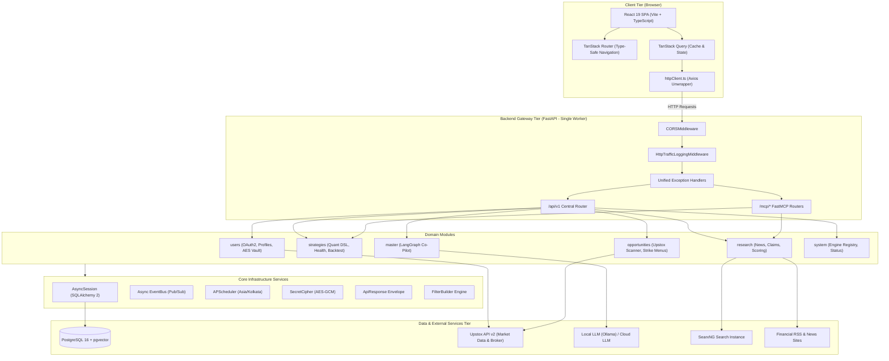
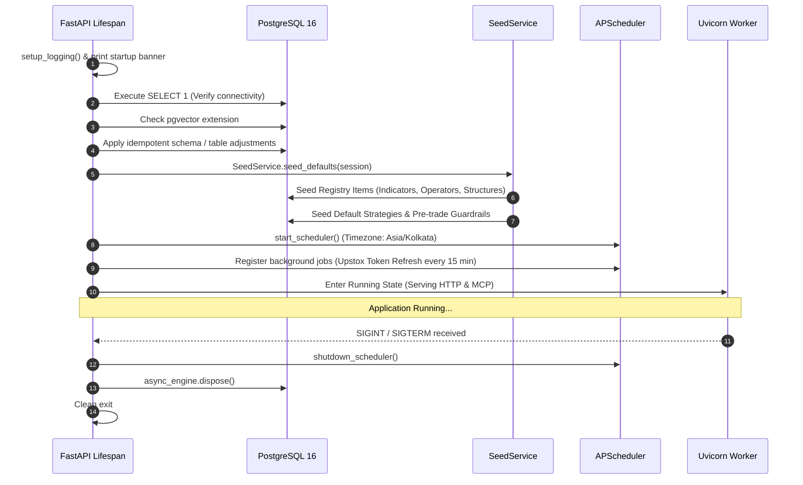

# 00. System Architecture & High-Level Design

> **Document Type:** System Architecture Specification  
> **Status:** Authoritative  
> **Repository:** `auto-trader`

---

## 1. Executive Summary

**Auto-Trader** is an algorithmic trading, autonomous quantitative intelligence, and market scanning platform built specifically for Indian financial markets (NSE, BSE, and MCX). It interfaces directly with **Upstox API v2** for live market data, option chain analysis, fund balance queries, and trade execution.

The platform marries deterministic quantitative execution with state-of-the-art AI orchestration:
1. **Deterministic Quant Core**: Rule evaluation ASTs, technical indicators (RSI, EMA, Supertrend, Bollinger Bands, ATR, VWAP), pre-trade risk guardrails, reliability calculations, and health diagnostics.
2. **Autonomous Market Research Engine**: 14-step autonomous research pipeline scraping RSS news, running SearxNG web searches, extracting claims, verifying facts, calculating sentiment weights, and performing semantic search via `pgvector`.
3. **Real-Time Opportunities Scanner**: Card-based live session scanner that continuously pulls market feeds from Upstox, models day context and volatility regimes, constructs strike menus, evaluates candidate strategies, and filters trades against vector trade memories.
4. **AI Master Co-Pilot**: A conversational quantitative agent orchestrated with **LangGraph** that interacts with quantitative models via Model Context Protocol (FastMCP) tools, translates trading concepts to ASTs, analyzes conflicts, and generates deployable strategy proposals.
5. **Multi-User Broker Management**: AES-GCM 256-bit encrypted credential vault with automated OAuth2 token refresh schedulers.

---

## 2. Technology Stack Matrix

| Architecture Layer | Technology | Key Details & Version |
|---|---|---|
| **Backend Language & Framework** | Python 3.12+, FastAPI | Asynchronous I/O, OpenAPI documentation |
| **Concurrency & Process Architecture** | **Single Uvicorn Worker** | Exactly 1 process (`--workers 1`). Schedulers, in-memory state, and active sessions are PID-bound |
| **Relational & Vector Database** | PostgreSQL 16 + `pgvector` | Plural `snake_case` tables, 768-dimensional vector embeddings |
| **ORM & Migrations** | SQLAlchemy 2 (async), Alembic | Fully asynchronous sessions, strict entity mapping |
| **Data Validation** | Pydantic v2 | Strict camelCase schemas matching frontend interfaces directly |
| **AI Orchestration** | LangGraph, LangChain Core | Cyclic state machines with checkpoints and step-by-step interrupts |
| **Tool Protocol** | FastMCP (Model Context Protocol) | Microservice tool exposure for strategies and research |
| **Scheduler** | APScheduler (`AsyncIOScheduler`) | Centralized scheduler bound to `Asia/Kolkata` timezone |
| **Cryptography** | `cryptography` (AES-GCM 256-bit) | Vault encryption with master key from environment |
| **External HTTP Client** | `httpx` (async) | Connection pooling, timeouts, and error handling |
| **Frontend Framework** | React 19, Vite, TypeScript | Modern component architecture, strict type checking |
| **Server State Management** | TanStack Query v5 | Query key factories, `keepPreviousData`, cache invalidations |
| **Client-Side Routing** | TanStack Router | File-agnostic route tree, type-safe path & search parameters |
| **Tables & Forms** | TanStack Table v8, React Hook Form + Zod | Manual server-side pagination, debounced filters, strict schemas |
| **Frontend HTTP Client** | Axios | Automatic envelope unwrapping and centralized `ApiError` dispatch |
| **Design System** | Tailored Trading Dark Theme | Zerodha Kite / Eye-Comfort Pro Trading Dark Palette |

---

## 3. High-Level System Topology



---

## 4. The Single Uvicorn Worker Principle

A core architectural invariant of **Auto-Trader** is running under **exactly one Uvicorn worker process**:

```bash
uvicorn app.main:app --host 0.0.0.0 --port 8000 --workers 1
```

### Why Single-Worker?
1. **In-Memory Active Sessions**: Real-time opportunity scans and interactive card sessions run continuous client-driven iteration cycles without requiring an external Redis broker for distributed locks.
2. **Centralized APScheduler**: The background scheduler (`APScheduler`) operates inside the FastAPI application process. Running multiple workers would result in duplicated scheduled jobs (e.g., duplicated Upstox token renewals or overlapping research runs).
3. **Deterministic Tool & Agent Memory**: FastMCP connections and LangGraph memory checkpoints are tied directly to the process runtime.
4. **Zero Inter-Worker Race Conditions**: Eliminates cache-coherence bugs and token refresh collisions during market pre-open hours.

---

## 5. Repository Directory Layout

The repository enforces a strict layered module layout. Every architectural layer is a dedicated folder, even when containing only one file:

```text
auto-trader/
├── arch.md                       # Core architectural rules & conventions
├── GEMINI.md                     # AI agent constraints & coding guidelines
├── AGENTS.md                     # Agent pointers
├── system-flow.md                # System specification
├── docker-compose.yml            # Local PostgreSQL + pgvector + SearxNG
├── docs/                         # Full project documentation suite
│
├── backend-service/
│   ├── pyproject.toml            # Poetry / Pip dependencies
│   ├── alembic.ini               # Alembic configuration
│   ├── alembic/                  # Database migration versions
│   └── app/
│       ├── main.py               # FastAPI application factory & lifespan
│       ├── core/                 # Shared system infrastructure
│       │   ├── config/           # Pydantic BaseSettings (settings.py)
│       │   ├── db/               # base_entity, session, status_type, entity_status
│       │   ├── response/         # api_response, response_helper
│       │   ├── filter/           # base_filter, date_filter, filter_builder
│       │   ├── pagination/       # page_result
│       │   ├── exception/        # app_exceptions, exception_handlers
│       │   ├── crypto/           # secret_cipher (AES-GCM)
│       │   ├── events/           # event_bus (typed async pub/sub)
│       │   ├── scheduler/        # scheduler (APScheduler Asia/Kolkata)
│       │   └── logging/          # logger, http_logger (rich traffic logger)
│       │
│       └── modules/              # Domain-specific modules
│           ├── master/           # AI Master Co-Pilot (LangGraph, MCP)
│           ├── strategies/       # Quant Strategies, Rules, Backtest, Health
│           ├── research/         # Autonomous Intelligence, Crawling, Scoring
│           ├── opportunities/    # Upstox Scanner, Strike Menu, Iterations
│           ├── users/            # User Accounts, Upstox OAuth2, Token Daemon
│           └── system/           # Status Service, Engine Registry
│
└── frontend/
    ├── package.json              # React 19 dependencies & scripts
    ├── vite.config.ts            # Vite bundler configuration
    ├── index.html                # Single-page application root
    └── src/
        ├── main.tsx              # Application bootstrap & DOM mount
        ├── index.css             # Kite trading dark palette CSS variables
        ├── app/
        │   ├── router/           # TanStack Router type-safe route tree
        │   └── providers/        # React Query, Router, Theme providers
        ├── core/                 # Core shared frontend components
        │   ├── api/              # Axios instance (httpClient), apiError
        │   ├── query/            # TanStack Query queryClient configuration
        │   ├── navigation/       # Menu registry & dynamic sidebar hooks
        │   ├── types/            # apiResponse, filter, pagination, baseEntity
        │   └── components/       # AppLayout, SideMenu, FilterBar, Tables
        └── modules/              # Domain-specific UI screens & hooks
            ├── master/           # Chat interface, proposal cards, message timeline
            ├── strategies/       # Strategy list, detail, visual editor, rules
            ├── research/         # Research cards, sentiment meters, thesis view
            ├── opportunities/    # Live session cards, iteration logs, strike list
            └── users/            # Accounts, Upstox connect dialog, funds display
```

---

## 6. Naming & Casing Standards (Zero Transformation Rule)

To prevent brittle key mappings, camel-to-snake converters, and serialization overhead, **Auto-Trader** adheres to a strict, universal casing rule:

```
┌─────────────────────────────────────────────────────────────┐
│ Database Layer (PostgreSQL)                                 │
│   • Tables: plural snake_case (e.g., trade_opportunities)   │
│   • Columns: snake_case (e.g., underlying_code)             │
└──────────────────────────────┬──────────────────────────────┘
                               │ SQLAlchemy mapped_column()
┌──────────────────────────────▼──────────────────────────────┐
│ Backend Layer (Python / FastAPI)                            │
│   • Entity Attributes: camelCase (e.g., underlyingCode)     │
│   • Pydantic Schemas:  camelCase (e.g., underlyingCode)     │
│   • Python Methods:    snake_case (e.g., get_candidates)    │
└──────────────────────────────┬──────────────────────────────┘
                               │ Direct JSON Serialization
┌──────────────────────────────▼──────────────────────────────┐
│ API Network Layer (JSON Payloads)                           │
│   • Request Body:  camelCase (e.g., { "underlyingCode" })   │
│   • Response Body: camelCase (e.g., { "underlyingCode" })   │
└──────────────────────────────┬──────────────────────────────┘
                               │ Zero-Mapping Ingestion
┌──────────────────────────────▼──────────────────────────────┐
│ Frontend Layer (TypeScript / React)                         │
│   • Interfaces & Types: camelCase (e.g., underlyingCode)    │
│   • Component State:    camelCase (e.g., underlyingCode)    │
└─────────────────────────────────────────────────────────────┘
```

**Key Invariant**: There is NO Pydantic `alias_generator` converting between camelCase and snake_case. Schema fields are named in camelCase directly. Frontend types consume the API payloads as-is.

---

## 7. Application Lifespan & Bootstrapping Sequence

The FastAPI application lifecycle is managed via `@asynccontextmanager` in `app/main.py`:



---

## 8. Cross-Cutting Architectural Patterns

### 8.1 Layering & Call Direction
```
Controller ──► Service ──► Repository ──► Entity
```
- **Controllers** only handle HTTP / MCP transport, validation, and status codes. They never access repositories directly.
- **Services** encapsulate business logic, raise subclasses of `AppException`, and never return raw HTTP responses.
- **Repositories** wrap SQLAlchemy async queries and database operations.
- **Cross-Module Calls**: A service in Module A may call a public Service in Module B, but never Module B's repository or internal helper.

### 8.2 Soft-Delete & Entity Status Lifecycle
All entities inherit from `BaseEntity`. Physical `DELETE` SQL statements are prohibited. Deleting an entity sets `status = EntityStatus.DELETED` (`0`). All queries default to filtering `WHERE status = 1`. Unique constraints on tables must use partial PostgreSQL indexes (`WHERE status = 1`) to allow reuse of natural keys after soft deletion.

### 8.3 Centralized Universal API Response Envelope
Every backend REST endpoint wraps its payload in the universal `ApiResponse[T]` format:
```json
{
  "statusCode": 200,
  "data": { ... },
  "message": "Operation completed successfully",
  "error": null
}
```
The frontend Axios wrapper unwraps `data` automatically, throwing structured `ApiError` instances on failures.

