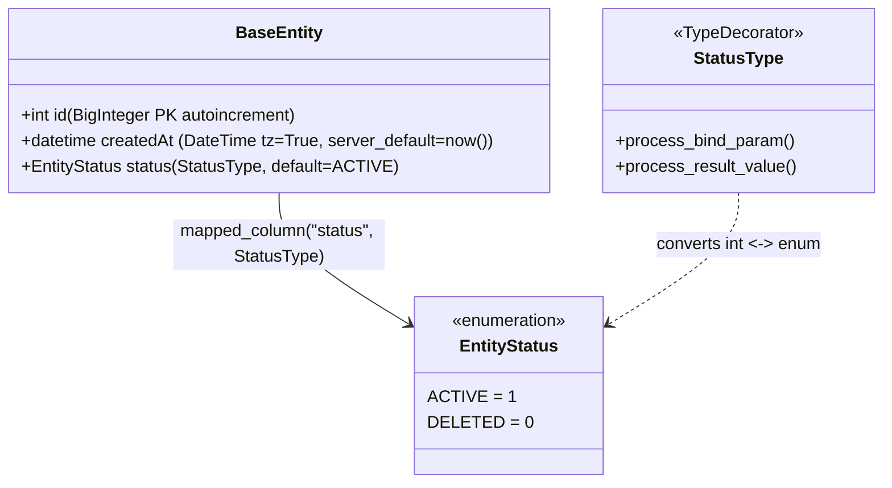
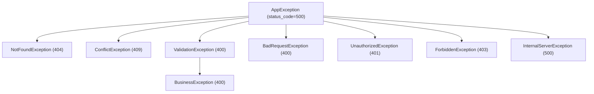

# 01. Core Infrastructure & Shared Services

> **Document Type:** Core Services Specification  
> **Module Path:** `backend-service/app/core/`  
> **Status:** Authoritative

---

## 1. Overview

The `app.core` package provides foundational, cross-cutting infrastructure components used across all business modules (`users`, `strategies`, `master`, `research`, `opportunities`, and `system`). It establishes mandatory patterns for:
- Database ORM modeling, identity, and soft-delete lifecycle
- Universal JSON API response envelopes and HTTP status coordination
- Search, date filtering, and server-side pagination standards
- Cryptographic vault security for sensitive broker tokens
- Single-process asynchronous event pub/sub dispatching
- Timezone-bound asynchronous background job scheduling
- Centralized exception hierarchy and request logging middleware

---

## 2. Database Architecture (`app.core.db`)

The database tier is built on **SQLAlchemy 2 (async)** and **PostgreSQL 16** with the `pgvector` extension.



### 2.1 Base Entity (`base_entity.py`)
All domain models in the platform inherit from `BaseEntity`:

```python
class BaseEntity(AsyncAttrs, DeclarativeBase):
    __abstract__ = True

    id: Mapped[int] = mapped_column(
        BigInteger, primary_key=True, autoincrement=True, index=True
    )
    createdAt: Mapped[datetime] = mapped_column(
        "created_at",
        DateTime(timezone=True),
        server_default=func.now(),
        nullable=False,
    )
    status: Mapped[EntityStatus] = mapped_column(
        "status",
        StatusType,
        nullable=False,
        default=EntityStatus.ACTIVE,
    )
```

### 2.2 Status Lifecycle & `StatusType` (`status_type.py`)
- In PostgreSQL, status is stored as a `smallint` (`1` = Active, `0` = Deleted).
- In Python code, status is strongly typed as `EntityStatus.ACTIVE` or `EntityStatus.DELETED`.
- `StatusType` (a SQLAlchemy `TypeDecorator`) handles strict bidirectional translation. If an unrecognized database value is encountered, it raises a `ValueError` immediately rather than defaulting silently.
- **Soft Deletion Rule**: Physical `DELETE` SQL queries are strictly prohibited across the codebase. Deletion is executed by setting `entity.status = EntityStatus.DELETED`.
- **Partial Unique Indexes**: Unique constraints must account for soft-deletes by specifying `WHERE status = 1`:
  ```sql
  CREATE UNIQUE INDEX uq_strategies_code ON strategies(code) WHERE status = 1;
  ```

### 2.3 Async Session Management (`session.py`)
Database connections use `create_async_engine` configured with `asyncpg`:
- `async_session_factory`: Sessionmaker configured with `expire_on_commit=False`.
- `get_db()`: Asynchronous dependency yielding an `AsyncSession` for FastAPI request scopes.

---

## 3. Universal API Response Envelope (`app.core.response`)

Every endpoint across all modules returns the standardized `ApiResponse[T]` payload envelope.

### 3.1 Envelope Schema
```json
{
  "statusCode": 200,
  "data": { ... },
  "message": "Operation completed successfully",
  "error": null
}
```

```python
class ApiResponse(BaseModel, Generic[T]):
    statusCode: int = Field(..., description="Matches the HTTP status code")
    data: Optional[T] = Field(None, description="Response payload on success, null on error")
    message: str = Field(..., description="Human-readable informational message")
    error: Optional[Any] = Field(None, description="Error details or validation array")
```

### 3.2 Response Helper (`response_helper.py`)
```python
def success(data: T = None, message: str = "Operation completed successfully", status_code: int = 200) -> ApiResponse[T]:
    return ApiResponse(statusCode=status_code, data=data, message=message, error=None)

def failure(status_code: int, message: str, error: Any = None) -> ApiResponse[None]:
    return ApiResponse(statusCode=status_code, data=None, message=message, error=error)
```

---

## 4. Search, Filter & Pagination Standards (`app.core.filter`, `app.core.pagination`)

To ensure consistent listing behaviors across tables, all search endpoints implement `POST /api/v1/<resource>/search` accepting a `BaseFilter` payload and returning `PageResult[T]`.

### 4.1 Filter Schema Matrix
- `BaseFilter`:
  - `page`: Zero-based integer (default `0`).
  - `limit`: Page size between 1 and 100 (default `10`).
  - `sortBy`: Column name string (default `"createdAt"`).
  - `sortDir`: Sort direction `"asc"` or `"desc"` (default `"desc"`).
  - `status`: Entity status filter (default `"ACTIVE"`).
  - `query`: Optional string for case-insensitive substring search.
  - `dateFilter`: Optional `DateFilter { from, to }` applied to `createdAt`.

### 4.2 Centralized `FilterBuilder` (`filter_builder.py`)
The `FilterBuilder` applies query criteria deterministically:
1. Filters on `entity.status == target_status` (defaults to `ACTIVE`).
2. Applies `dateFilter` bounds (`from_ <= createdAt <= to`).
3. Performs case-insensitive substring searches (`ilike(%query%)`) across registered model fields using `or_()`.
4. Calculates total count via `select(func.count()).select_from(base_stmt.subquery())`.
5. Applies ordering via `asc()` / `desc()` on mapped column properties.
6. Applies `offset(page * limit).limit(limit)`.
7. Returns `PageResult[T]` with `list`, `page`, `limit`, `totalPages`, and `totalItems`.

---

## 5. Cryptographic Vault (`app.core.crypto`)

Sensitive broker secrets—including the Upstox `apiKey`, `apiSecret`, and OAuth `accessToken`—must never be stored in plain text or returned to the frontend.

### 5.1 AES-GCM 256-bit Cipher (`secret_cipher.py`)
- **Key Derivation**: The master key string is loaded from `APP_MASTER_ENCRYPTION_KEY` in `settings.py`. It is passed through SHA-256 to ensure a cryptographic 32-byte (256-bit) key.
- **Nonce & Tag**: Every encryption generates a fresh, cryptographically secure 96-bit (12-byte) initialization nonce using `os.urandom(12)`.
- **Payload Format**: The resulting ciphertext includes the 16-byte Poly1305 authentication tag appended to the ciphertext. The combined output is encoded in Base64:
  $$\text{Payload} = \text{Base64}\left(\text{Nonce}_{12} \parallel \text{Ciphertext} \parallel \text{Tag}_{16}\right)$$
- Decryption validates payload length ($\ge 28$ bytes) and authenticates data integrity before returning plaintext.

---

## 6. Asynchronous In-Process Event Bus (`app.core.events`)

The platform implements an in-memory, decoupled event pub/sub mechanism (`event_bus.py`) to broadcast state changes across modules without circular imports.

```python
class EventBus:
    def subscribe(self, event_type: str, handler: Callable[[Any], Awaitable[None]]) -> None: ...
    async def publish(self, event_type: str, payload: Any = None) -> None: ...
```

- When `publish()` is called, all registered async handlers are invoked concurrently using `asyncio.gather(*tasks, return_exceptions=True)`.
- Individual handler errors are trapped and logged to prevent cascading failures.

---

## 7. In-Process Scheduler (`app.core.scheduler`)

Background recurring jobs run within the single Uvicorn process using **APScheduler** (`AsyncIOScheduler`):
- **Timezone**: Bound strictly to `Asia/Kolkata` (`IST`).
- **Lifecycle**: Initialized in `lifespan` of `main.py` via `start_scheduler()` and gracefully shut down with `shutdown_scheduler()`.
- **Registered Jobs**:
  - `users.upstox_token_refresh`: Runs every 15 minutes, inspecting expiring tokens and renewing them before market sessions.
  - `sessions.archive_session_picks`: Runs daily at 16:00 IST (and once at startup) and moves the picks of finished trading sessions from `session_picks` to `session_picks_archive`; see [10](10-sessions-module.md).

---

## 8. Exception Hierarchy & Handlers (`app.core.exception`)

All business services raise subclasses of `AppException`. Services never construct FastAPI `HTTPException` or return error envelopes directly.



### 8.1 Global Exception Handlers (`exception_handlers.py`)
Registered in `main.py` to translate all exceptions into unified `ApiResponse` format:
- `AppException`: Mapped to its defined `status_code`, returns `{ statusCode, data: null, message, error }`.
- `RequestValidationError` (Pydantic / FastAPI): Returns HTTP 400 with `error` containing an array of `[{ field, message }]`.
- `SQLAlchemyError`: Logs root cause internally; returns HTTP 500 with generic error message to prevent database schema leakage.
- Unhandled `Exception`: Returns HTTP 500 with message `"An unexpected internal error occurred"`.

---

## 9. HTTP Traffic Logging Middleware (`app.core.logging`)

`HttpTrafficLoggingMiddleware` provides rich, colorized terminal logging for every HTTP request and response:
- Logs HTTP Method, URL Path, Status Code, and Execution Duration (in ms).
- Inspects and colorizes response codes (Green for 2xx, Yellow for 3xx, Red for 4xx/5xx).
- Formats payloads and headers in development mode for instantaneous debugging.

