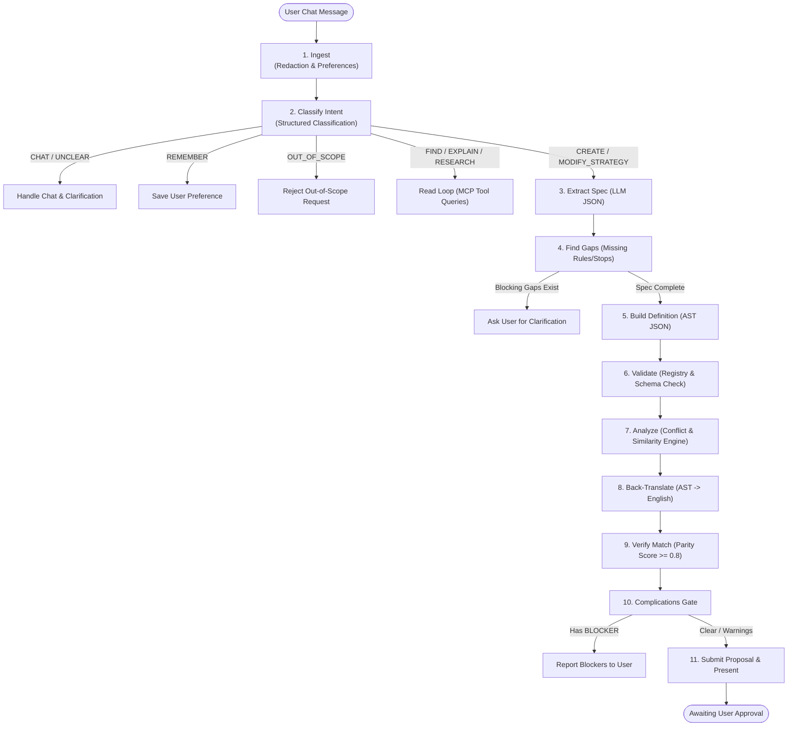
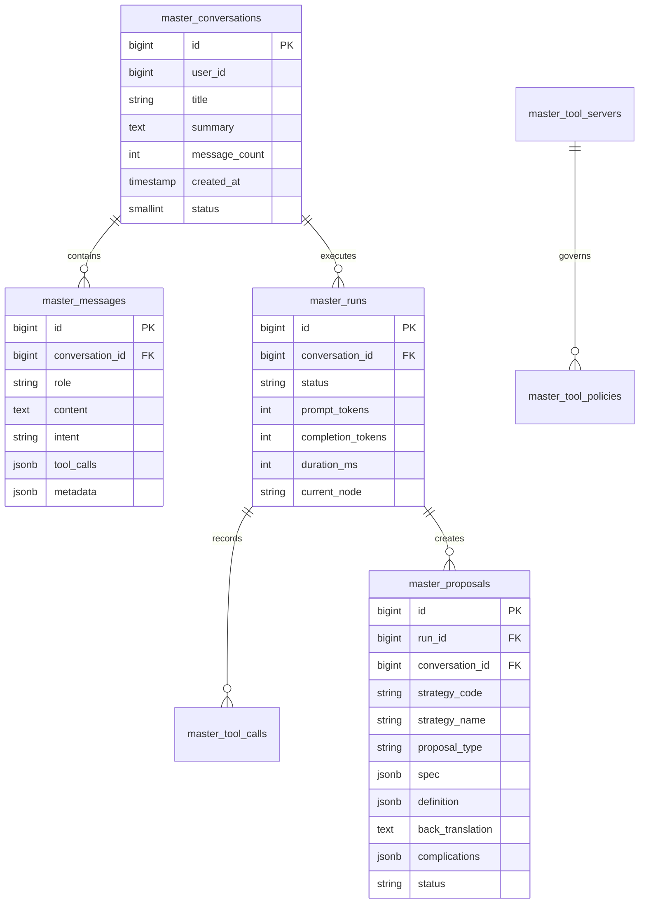

# 02. Master AI Module (Conversational Co-Pilot)

> **Document Type:** Domain Module Specification  
> **Module Path:** `backend-service/app/modules/master/`  
> **Frontend Module:** `frontend/src/modules/master/`  
> **Status:** Authoritative

---

## 1. Executive Overview

The **Master AI Module** functions as an intelligent, conversational quantitative co-pilot. It bridges natural-language trading ideas from the user to rigorously validated algorithmic strategies, AST definitions, and quantitative proposals.

Unlike unstructured chatbots, the Master is designed as a **deterministic, multi-stage LangGraph state machine**. It executes tool calls exclusively through the Model Context Protocol (FastMCP), validates definitions against registry items, checks for rule conflicts, runs back-translation to English to ensure mathematical parity, and requires explicit user confirmation before any strategy proposal is committed to the database.

---

## 2. Core Architecture & Workflow Lifecycle



---

## 3. The 11-Step LangGraph Workflow

The execution graph (`MasterWorkflowRunner`) enforces an 11-step pipeline for strategy authoring:

### Step 1: Ingest (`ingest`)
- Sanitizes user input through `RedactionService.redact_text()`, masking API keys, phone numbers, and secrets.
- Loads persistent user preferences (e.g., favorite underlying, risk appetite, default timeframe).
- Records `run.started` event with run ID.

### Step 2: Intent Classification (`classify_intent`)
Classifies the message into one of eight distinct intents using structured output:
- `CREATE_STRATEGY`: New quantitative strategy creation.
- `MODIFY_STRATEGY`: Adjusting rules, stop-losses, or indicators on an existing strategy.
- `FIND`: Searching strategies, rules, or registry indicators.
- `EXPLAIN`: Explaining the mechanics or performance of an existing strategy.
- `RESEARCH`: Requesting news clearance, sentiment analysis, or macro market context.
- `REMEMBER`: Explicit preference storage ("Remember that my max loss per day is Rs 5,000").
- `CHAT`: General trading conversation or greeting.
- `OUT_OF_SCOPE`: Non-trading tasks (e.g., general coding, creative writing).

### Step 3: Spec Extraction (`extract_spec`)
Transforms natural language into a structured quantitative specification (`ExtractedSpec`):
- Direction: `LONG`, `SHORT`, or `BOTH`.
- Underlyings: Array of symbols (e.g., `["NIFTY", "BANKNIFTY"]`).
- Timeframe: Candle interval (e.g., `5m`, `15m`, `1d`).
- Entry conditions, Exit conditions, Stop-Loss type & parameters, Target parameters.

### Step 4: Gap Detection & User Interview (`find_gaps` & `ask_user`)
- Evaluates whether essential trading parameters are missing (e.g., missing risk-to-reward ratio, unspecified stop loss).
- If blocking gaps exist and clarification rounds $< 3$, pauses the graph, presents targeted questions, and requests user answers.

### Step 5: Build Definition (`build_definition`)
Generates the formal Strategy AST definition dictionary matching the `auto-trader` schema:
```json
{
  "name": "Nifty EMA Scalp",
  "direction": "LONG",
  "timeframe": "5m",
  "underlying": "NIFTY",
  "entry": {
    "all": [
      { "indicator": "EMA", "period": 9, "operator": "CROSSES_ABOVE", "target": { "indicator": "EMA", "period": 21 } }
    ]
  },
  "stopLoss": { "type": "POINTS", "value": 25.0 },
  "target": { "type": "POINTS", "value": 50.0 }
}
```

### Step 6: AST Validation (`validate`)
Calls the Strategy Module `DefinitionValidator`:
- Validates all indicators, operators, and price sources against `registry_items`.
- Verifies parameter boundaries (e.g., EMA period $\in [2, 500]$).
- Rejects non-executable or unsupported configurations.

### Step 7: Conflict & Similarity Analysis (`analyze`)
- Invokes `ConflictAnalyzer` to detect internal logical contradictions (e.g., RSI > 70 AND RSI < 30 simultaneously).
- Invokes `SimilarityService` to calculate token and AST similarity against all existing strategies in the database. Warns if an identical strategy already exists.

### Step 8: Back-Translation (`back_translate`)
A deterministic, rule-based decompiler converts the compiled AST back into rigorous, unambiguous plain English:
> *"Buy NIFTY 5-minute options when 9-period EMA crosses above 21-period EMA. Stop loss is fixed at 25 points. Profit target is fixed at 50 points."*

### Step 9: Parity Verification (`verify_match`)
An LLM judge compares the user's original request against the back-translated English text:
- Scores parity between $0.0$ and $1.0$.
- Flags any discrepancy or missed user constraint. Parity score must exceed $0.80$ to proceed.

### Step 10: Complications Gate (`complications_gate`)
Aggregates all warnings, conflicts, similarity alerts, and guardrail cautions into structured complications:
- Severity levels: `INFO`, `WARNING`, `BLOCKER`.
- If any complication has severity `BLOCKER`, halts pipeline and presents diagnostic failure to the user.

### Step 11: Proposal Submission (`submit_proposal`)
- Persists an immutable draft proposal in the `master_proposals` table.
- Emits a proposal card to the UI containing:
  - Strategy metadata and parameters.
  - Interactive rule diff viewer.
  - Back-translated plain English explanation.
  - Severity-tagged complications list.
  - **Approve & Deploy** or **Reject** action buttons.

---

## 4. Model Context Protocol (FastMCP) Tool Gateway

The Master agent interacts with external modules via FastMCP:

```mermaid
graph LR
    Master["Master AI Agent"] --> Gateway["ToolGateway"]
    Gateway --> Policy{"Tool Policy Check"}
    Policy -->|Allowed (READ)| MCP_Strat["Strategy FastMCP Server<br/>(/mcp/strategies)"]
    Policy -->|Allowed (READ)| MCP_Res["Research FastMCP Server<br/>(/mcp/research)"]
    Policy -->|Blocked / MUTATE| Reject["Reject / Require User Confirmation"]
    
    MCP_Strat --> Tools_Strat["list_registry<br/>get_registry_item<br/>validate_strategy<br/>diff_strategies<br/>explain_strategy<br/>analyze_conflicts"]
    MCP_Res --> Tools_Res["get_latest_results<br/>get_candidate<br/>search_research"]
```

### 4.1 Tool Tiers & Permissions
- **READ Tier**: Read-only queries (e.g., reading indicator registry, checking research scores). Can be executed automatically without confirmation.
- **MUTATE Tier**: Writes or updates (e.g., modifying database records). Strictly gated behind interactive proposals and confirmation tokens.

---

## 5. Database Schema & Entities



---

## 6. REST API Endpoints (`master_router`)

All endpoints are registered under `/api/v1/master`:

| Method | Endpoint | Description |
|---|---|---|
| `POST` | `/api/v1/master/conversations` | Create a new Master conversation thread |
| `POST` | `/api/v1/master/conversations/search` | Search and paginate user conversations (`BaseFilter`) |
| `GET` | `/api/v1/master/conversations/{id}` | Get conversation metadata and details |
| `PATCH` | `/api/v1/master/conversations/{id}` | Rename conversation title |
| `DELETE` | `/api/v1/master/conversations/{id}` | Soft-delete conversation thread |
| `POST` | `/api/v1/master/conversations/{id}/messages` | Post a user message and trigger LangGraph execution turn |
| `POST` | `/api/v1/master/conversations/{id}/messages/search` | Fetch message history for a conversation |
| `GET` | `/api/v1/master/proposals/{id}` | Fetch detailed proposal with AST diff and complications |
| `POST` | `/api/v1/master/proposals/{id}/approve` | Approve proposal: persists strategy to active quant registry |
| `POST` | `/api/v1/master/proposals/{id}/reject` | Reject proposal with optional user feedback notes |
| `GET` | `/api/v1/master/tools` | List registered FastMCP tools, servers, and policy permissions |
| `GET` | `/api/v1/master/preferences` | Retrieve user preferences (underlyings, risk tolerances) |
| `PUT` | `/api/v1/master/preferences` | Update or upsert user preferences |

