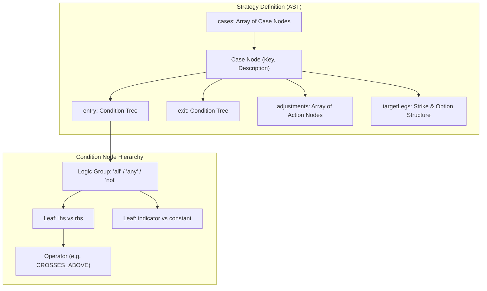
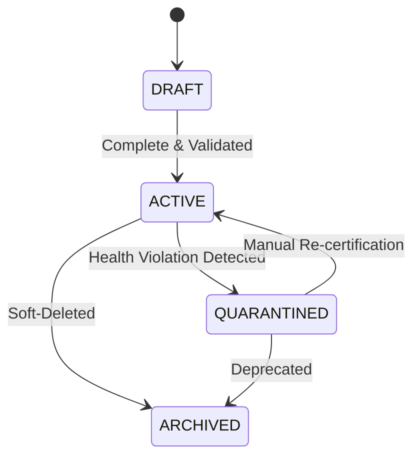
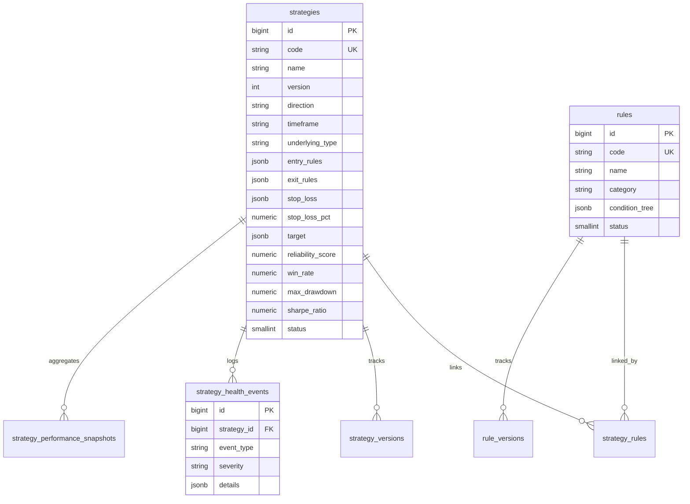

# 03. Strategies & Rules Module (Quantitative DSL & Health)

> **Document Type:** Domain Module Specification  
> **Module Path:** `backend-service/app/modules/strategies/`  
> **Frontend Module:** `frontend/src/modules/strategies/`  
> **Status:** Authoritative

---

## 1. Executive Overview

The **Strategies & Rules Module** is the deterministic quantitative core of Auto-Trader. It manages the lifecycle, mathematical validation, AST definition, evaluation, backtesting, and diagnostic health monitoring of quantitative trading strategies and reusable modular rules.

Key capabilities include:
- **Rule-Tree DSL & AST**: Standardized syntax for condition nodes, boolean logical combinators (`all`, `any`, `not`), operators (`GREATER_THAN`, `CROSSES_ABOVE`, `IS_BETWEEN`), and indicators.
- **Rule Evaluation Engine (`RuleEvaluator`)**: High-speed, stateless evaluation of strategy definitions against live or historical market feature contexts.
- **Backtesting & Technical Indicators (`BacktestService`, `BacktestIndicators`)**: Computes Wilder's RSI, EMA, SMA, ATR, CCI, VWAP, and Supertrend on OHLCV bars.
- **Reliability Scoring Engine (`ReliabilityCalculator`)**: Multi-factor scoring accounting for sample size, win rate, Sharpe ratio, Sortino ratio, and max drawdown.
- **Automated Health & Quarantine (`HealthService`)**: Tracks consecutive losses, drawdown violations, and automatically transitions underperforming strategies to `QUARANTINED` status.
- **Conflict & Semantic Similarity Engine (`ConflictAnalyzer`, `SimilarityService`)**: Detects logical contradictions and rule overlaps before strategies are deployed.
- **FastMCP Tool Server (`strategy_mcp_server.py`)**: Exposes read/analyze tools to the AI Master agent.

---

## 2. Strategy & Rule DSL Architecture

Strategies and rules in Auto-Trader are defined using a structured JSON Abstract Syntax Tree (AST). This format is fully serialized in the database and directly consumed by the execution engines.



### 2.1 Condition Node Example
```json
{
  "all": [
    {
      "lhs": { "indicator": "EMA", "period": 9 },
      "operator": "CROSSES_ABOVE",
      "rhs": { "indicator": "EMA", "period": 21 }
    },
    {
      "lhs": { "indicator": "RSI", "period": 14 },
      "operator": "GREATER_THAN",
      "rhs": { "constant": 55.0 }
    },
    {
      "lhs": { "market": "TIME" },
      "operator": "IS_BETWEEN",
      "rhs": { "from": "09:30", "to": "14:45" }
    }
  ]
}
```

### 2.2 Supported Operators
The AST supports operators registered in `registry_items`:
- **Relational**: `EQUALS`, `NOT_EQUALS`, `GREATER_THAN`, `LESS_THAN`, `GREATER_THAN_OR_EQUAL`, `LESS_THAN_OR_EQUAL`.
- **Crossover**: `CROSSES_ABOVE`, `CROSSES_BELOW` (evaluated by inspecting current and prior candle values).
- **Range**: `IS_BETWEEN`, `IS_OUTSIDE`.
- **Logical**: `all` (AND), `any` (OR), `not` (NEGATION).

---

## 3. Evaluation & Indicators Engine

### 3.1 `RuleEvaluator`
The `RuleEvaluator` evaluates a strategy's compiled definition against a dynamic `context` dictionary containing:
- Live market prices (`spot`, `bid`, `ask`).
- Indicator feature maps (`context["indicators"]["EMA_9"]`, `context["indicators"]["RSI_14"]`).
- Time-of-day and candle sequence numbers.

It produces an `EvaluateStrategyResponse`:
- `entryMet`: Boolean flag indicating whether all entry rules evaluated to true.
- `exitMet`: Boolean flag indicating whether exit or stop conditions triggered.
- `activeCaseKey`: Key of the winning case node.
- `conditions`: Step-by-step audit trace of every condition evaluated with its observed runtime value and boolean pass/fail status.

### 3.2 Technical Indicators Math (`BacktestIndicators`)
- **RSI (Relative Strength Index)**: Wilder's smoothing technique:
  $$\text{RS} = \frac{\text{EMA}(\text{Gain}, n)}{\text{EMA}(\text{Loss}, n)}, \quad \text{RSI} = 100 - \frac{100}{1 + \text{RS}}$$
- **EMA / SMA**: Exponential and Simple Moving Averages.
- **Supertrend**: True Range multiplied by factor, shifting upper and lower bands based on directional close crossovers.
- **VWAP**: Cumulative volume-weighted average price $\sum (P \cdot V) / \sum V$.

---

## 4. Reliability Scoring Engine (`ReliabilityCalculator`)

Strategies receive a dynamic reliability score ($0.0$ to $100.0$) calculated from historical trade performance snapshots:

$$\text{ReliabilityScore} = w_{\text{sample}} \cdot \left[ 0.4 \cdot \text{WinRate} + 0.3 \cdot \min\left(\frac{\text{Sharpe}}{3.0}, 1.0\right) + 0.3 \cdot \left(1.0 - \min\left(\frac{\text{MaxDD}}{0.25}, 1.0\right)\right) \right] \times 100$$

Where the sample size dampener is:
$$w_{\text{sample}} = \min\left(\frac{N_{\text{trades}}}{30}, 1.0\right)$$
If a strategy has fewer than 30 completed trades, its score is discounted proportionally to guard against small-sample variance.

---

## 5. Health Diagnostics & Automated Quarantine



### 5.1 Health Policies & Diagnostics (`HealthService`)
The health engine periodically evaluates active strategies against `health_policies`:
1. **Consecutive Losses Threshold**: Triggered when a strategy exceeds $K$ sequential losing trades (default 4).
2. **Max Drawdown Violation**: Triggered if intraday or cumulative equity drawdown exceeds configured limit (e.g. 15%).
3. **Low Win Rate Quarantine**: Triggered if win rate drops below 40% after at least 20 trades.
4. **Auto-Quarantine Execution**: When a policy violation occurs:
   - A `StrategyHealthEventEntity` is logged with severity `CRITICAL`.
   - The strategy's status is changed from `ACTIVE` to `QUARANTINED`.
   - Live scanners (such as Opportunities) immediately cease generating new orders for the strategy.

---

## 6. Pre-Trade Guardrails (`GuardrailService`)

Before any trade is emitted or simulated, it is checked against mandatory pre-trade guardrails:
- **Max Capital Exposure per Trade**: Ensures no single contract position exceeds a preset percentage of user equity.
- **Maximum Daily Loss Limit**: Halts order generation if cumulative day losses reach the account circuit-breaker.
- **Slippage Bounds**: Rejects orders where the option bid-ask spread is wider than allowed threshold.
- **Market Timing Window**: Restricts strategy execution to liquid trading windows (e.g., blocks execution during the opening 15 minutes 09:15-09:30 and pre-market sessions).

---

## 7. FastMCP Strategy Tool Server (`strategy_mcp_server.py`)

Exposes strategy tools to the AI Master co-pilot:

| MCP Tool Name | Tier | Purpose |
|---|---|---|
| `list_registry` | `READ` | Lists available indicators, operators, strike selectors, and stop types |
| `get_registry_item` | `READ` | Retrieves input schemas and parameter ranges for a specific registry code |
| `validate_strategy` | `READ` | Validates an AST strategy definition against schemas and rules |
| `diff_strategies` | `READ` | Computes semantic JSON diff between two versions of a strategy |
| `explain_strategy` | `READ` | Generates a plain-English explanation of a strategy AST |
| `analyze_conflicts` | `READ` | Detects logical contradictions (e.g. impossible simultaneous conditions) |

---

## 8. Database Schema & Entities



---

## 9. REST API Endpoints (`strategy_router`, `rule_router`)

All endpoints are registered under `/api/v1/strategies` and `/api/v1/rules`:

| Method | Endpoint | Description |
|---|---|---|
| `POST` | `/api/v1/strategies` | Create a new quantitative strategy |
| `POST` | `/api/v1/strategies/search` | Search and paginate strategies (`BaseFilter`) |
| `GET` | `/api/v1/strategies/{id}` | Get strategy details with full AST and indicators |
| `PUT` | `/api/v1/strategies/{id}` | Update strategy definition (increments version) |
| `DELETE` | `/api/v1/strategies/{id}` | Soft-delete strategy |
| `POST` | `/api/v1/strategies/{id}/evaluate` | Run `RuleEvaluator` against provided market context |
| `POST` | `/api/v1/strategies/{id}/backtest` | Run historical backtest on daily or intraday OHLCV bars |
| `GET` | `/api/v1/strategies/{id}/diagnostics`| Retrieve health events, policy status, and quarantine state |
| `POST` | `/api/v1/strategies/{id}/quarantine` | Manually quarantine a strategy |
| `POST` | `/api/v1/strategies/{id}/restore` | Restore a quarantined strategy to active status |
| `POST` | `/api/v1/rules` | Create a reusable rule |
| `POST` | `/api/v1/rules/search` | Search and paginate rules |
| `GET` | `/api/v1/rules/{id}` | Get rule details and condition AST |
| `PUT` | `/api/v1/rules/{id}` | Update rule definition |
| `DELETE` | `/api/v1/rules/{id}` | Soft-delete rule |

