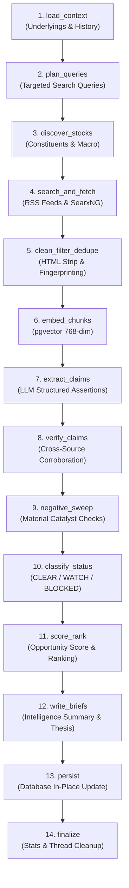
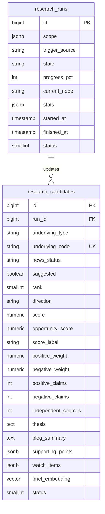

# 04. Research Engine Module (Autonomous Market Intelligence)

> **Document Type:** Domain Module Specification  
> **Module Path:** `backend-service/app/modules/research/`  
> **Frontend Module:** `frontend/src/modules/research/`  
> **Status:** Authoritative

---

## 1. Executive Overview

The **Research Engine** is an autonomous market intelligence gathering and evaluation pipeline. It continuously scans financial news feeds, runs targeted web searches, and extracts verifiable factual claims for major Indian market underlyings:
- **Indices**: NIFTY, BANKNIFTY, FINNIFTY, SENSEX, MIDCPNIFTY.
- **Commodities**: GOLD, CRUDEOIL, SILVER, NATURALGAS.

The engine's primary objective is **negative risk detection and sentiment clearance**. Quantitative algorithms in Auto-Trader will not initiate long positions on underlyings plagued by material adverse news (e.g., regulatory crackdowns, SEBI probes, sudden geopolitical disruptions, or earnings shocks). Conversely, strong directional clarity produces an `opportunityScore` that prioritizes active scanning in the Opportunities module.

---

## 2. The 14-Step Autonomous Research Pipeline

The research pipeline (`ResearchWorkflowRunner`) runs as an asynchronous multi-stage pipeline:

### Detailed Pipeline Breakdown:

1. **`load_context`**: Loads target symbols (`INDEX`, `COMMODITY`), past claim histories, and active runs from `research_candidates`.
2. **`plan_queries`**: Formulates diverse search queries for each asset (e.g. `"NIFTY 50 technical outlook RBI policy"`, `"Crude oil OPEC supply cuts MCX"`).
3. **`discover_stocks`**: Expands index queries to cover top heavyweights (e.g., HDFC Bank, Reliance for NIFTY).
4. **`search_and_fetch`**:
   - Reads RSS feeds from major Indian financial portals (Moneycontrol, Economic Times, Livemint, Business Standard, Reuters India) via `RSSReader`.
   - Executes web searches via `SearxNGClient`.
   - Fetches article HTML via `PoliteFetcher` honoring `RobotsCache` and domain rate limits.
5. **`clean_filter_dedupe`**: Strips boilerplates, navigation elements, ads, and deduplicates articles based on SimHash/MD5 content hashes.
6. **`embed_chunks`**: Uses `EmbeddingClient` to compute 768-dimensional text embeddings of article paragraphs and stores them in PostgreSQL with `pgvector`.
7. **`extract_claims`**: LLM prompts extract structured claims with attributes: `fact`, `entity`, `sentiment` (`BULLISH`, `BEARISH`, `NEUTRAL`), and `severity`.
8. **`verify_claims`**: Cross-verifies claims across multiple independent publishers. Single-source rumors are discounted.
9. **`negative_sweep`**: High-priority scan for critical catalysts: SEBI notices, rating downgrades, management resignations, geopolitical strikes, or interest rate spikes.
10. **`classify_status`**: Categorizes the news clearance status:
    - `CLEAR`: Clean newsflow, no material negatives. Safe for execution.
    - `WATCH`: Low-severity negatives or mixed rumors. Requires tighter stop losses.
    - `BLOCKED`: Severe material negatives. Live strategy execution halted.
11. **`score_rank`**: Computes `opportunityScore` ($0$ to $100$) and assigns relative rankings $1 \dots N$.
12. **`write_briefs`**: Generates a Daily Intelligence Brief (`blogSummary`), bullet-point thesis, and citations list.
13. **`persist`**: Updates `research_candidates` in-place inside an atomic database transaction.
14. **`finalize`**: Logs run execution metrics, duration, token counts, and transitions `ResearchRun.state` to `COMPLETED`.

---

## 3. Mathematical Scoring Model (`score_rank.py`)

The scoring model rewards overwhelming sentiment clarity backed by independent sources while penalizing contradictory news:

### 3.1 Opportunity Score Formula
$$\text{OpportunityScore} = 100 \cdot S_{\text{strength}} \cdot C_{\text{clarity}} \cdot F_{\text{coverage}}$$

Where:
- **Dominant Weight**: $W_{\text{dom}} = \max(W_{\text{pos}}, W_{\text{neg}})$
- **Asymptotic Strength**:
  $$S_{\text{strength}} = 1.0 - \exp\left(-\frac{W_{\text{dom}}}{5.0}\right)$$
- **Clarity Factor**:
  $$C_{\text{clarity}} = 2 \cdot \left(\frac{W_{\text{dom}}}{W_{\text{pos}} + W_{\text{neg}}}\right) - 1.0 \quad (\text{yields } 1.0 \text{ when 100\% one-sided, } 0.0 \text{ when 50/50})$$
- **Source Coverage Factor**:
  $$F_{\text{coverage}} = \min\left(1.0, \frac{N_{\text{sources}}}{2 \cdot N_{\text{min\_sources}}}\right)$$

### 3.2 Directional Assignment
- If $W_{\text{pos}} \ge W_{\text{neg}}$ and $\text{OpportunityScore} > 0 \implies \text{Direction} = \text{"BULLISH"}$
- If $W_{\text{neg}} > W_{\text{pos}}$ and $\text{OpportunityScore} > 0 \implies \text{Direction} = \text{"BEARISH"}$
- Label: `HIGH` ($\ge 70$, $\ge 5$ sources), `MEDIUM` ($\ge 50$), `LOW` ($< 50$).

---

## 4. Web Ingestion & Politeness (`app.modules.research.fetch`)

To comply with ethical scraping guidelines and prevent IP bans:
- **`RobotsCache`**: Fetches and parses `robots.txt` per domain, honoring crawl delays and disallow directives.
- **`PoliteFetcher`**: Asynchronous HTTP client with connection pooling, exponential backoff, randomized user-agents, and minimum 1.5s spacing between requests to the same origin.
- **`RSSReader`**: High-frequency RSS feed polling that parses structured `<item>` entries, timestamps, and author fields without scraping main page HTML.

---

## 5. FastMCP Research Tool Server (`research_mcp_server.py`)

Exposes market intelligence to other modules and the AI Master agent:

| MCP Tool Name | Tier | Purpose |
|---|---|---|
| `get_latest_results` | `READ` | Fetches evaluated candidates (scores, clearance, bullish/bearish weights) |
| `get_candidate` | `READ` | Fetches deep-dive intelligence: blog summary, catalyst news, thesis, and watch items |
| `search_research` | `READ` | Semantic vector search across embedded news chunks using `pgvector` |
| `run_research` | `MUTATE` | Triggers a fresh 14-step research execution run |

---

## 6. Database Schema & Entities

---

## 7. REST API Endpoints (`research_router`)

All endpoints are registered under `/api/v1/research`:

| Method | Endpoint | Description |
|---|---|---|
| `GET` | `/api/v1/research/candidates` | List current evaluated candidates for `INDEX` and `COMMODITY` |
| `GET` | `/api/v1/research/candidates/{symbol}` | Get deep-dive intelligence, thesis, blog summary, and news |
| `POST` | `/api/v1/research/runs` | Trigger a new manual research run with custom scope |
| `POST` | `/api/v1/research/runs/search` | Search and paginate historical research runs (`BaseFilter`) |
| `GET` | `/api/v1/research/runs/{id}` | Get status, current node, and progress percentage of an active run |
| `POST` | `/api/v1/research/runs/{id}/cancel` | Cancel an in-flight research run |
| `POST` | `/api/v1/research/search` | Perform cosine vector similarity search over news claims |

