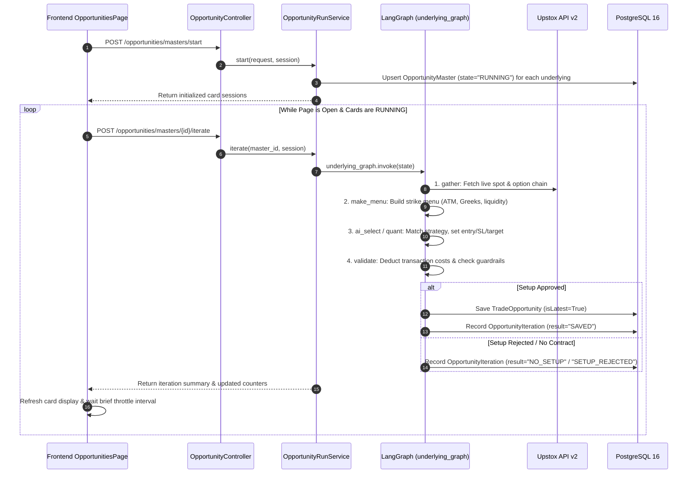
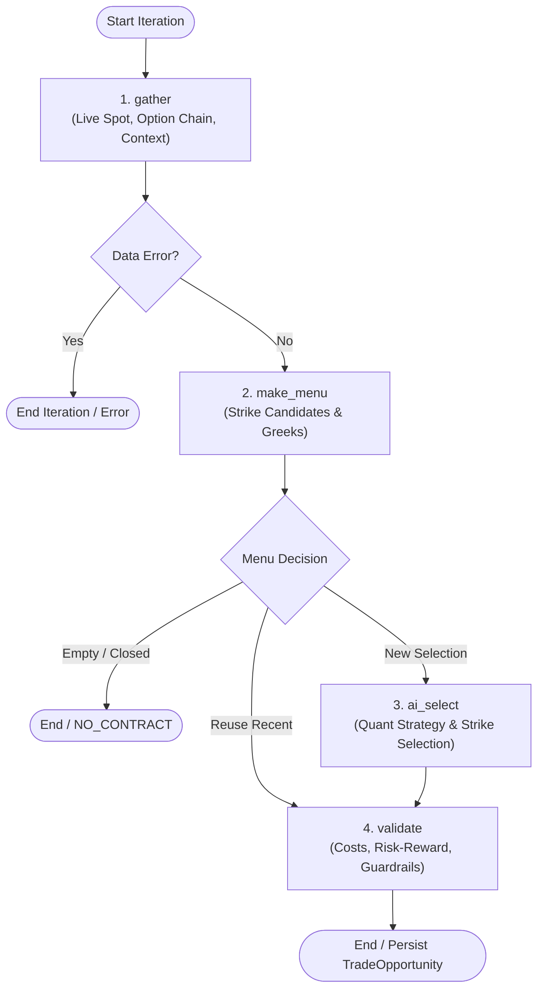
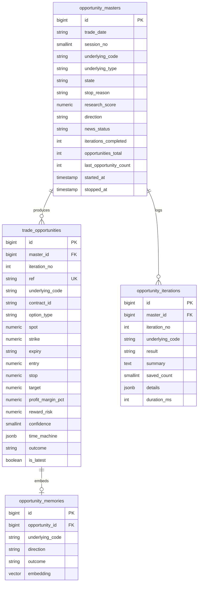

# 05. Opportunities Module (Real-Time Trade Scanner)

> **Document Type:** Domain Module Specification  
> **Module Path:** `backend-service/app/modules/opportunities/`  
> **Frontend Module:** `frontend/src/modules/opportunities/`  
> **Status:** Authoritative

---

## 1. Executive Overview

The **Opportunities Module** is Auto-Trader's real-time intraday trading scanner. It bridges macro sentiment and quantitative strategies with live market data from **Upstox API v2**.

The module operates on a **card session loop architecture**:
1. When the user clicks **Start Scanner** on the UI, an `OpportunityMaster` session card is initialized for each target underlying (e.g. NIFTY, BANKNIFTY, SENSEX, CRUDEOIL, GOLD).
2. The frontend continuously iterates running cards one by one via `POST /api/v1/opportunities/masters/{id}/iterate`.
3. Each iteration executes an asynchronous LangGraph decision workflow (`underlying_graph`), gathering live quotes, constructing an option strike menu, evaluating quantitative strategy rules, deducting realistic Indian transaction charges, and storing winning trade setups in `trade_opportunities`.
4. Detailed diagnostic events are recorded in `opportunity_iterations` for every batch—even when zero trades are found.
5. Saved opportunities are later read (never driven) by the **Trading Sessions** loop; see [10. Trading Sessions Module](10-sessions-module.md).

---

## 2. Card Session Architecture & Execution Loop



---

## 3. The 4-Node LangGraph Decision Graph

Each iteration of an active card executes `underlying_graph` (`builder.py`):



### Node Details:
1. **`gather`**:
   - Fetches live underlying spot price and OHLCV daily/intraday bars via `UpstoxMarketDataProvider`.
   - Computes intraday ATR, EMA(9), EMA(21), Supertrend, and VWAP.
   - Computes `DayContext`: trend direction, volatility regime, expiry day flag, and hour bucket ($0 \dots 6$).
   - Queries `OpportunityMemory` using `Vector(768)` embeddings to retrieve historical trades with similar technical patterns.
2. **`make_menu`**:
   - Queries the Upstox Option Chain for the nearest weekly/monthly expiry.
   - Filters strikes: selects At-The-Money (ATM), In-The-Money (ITM 1-2), and Out-of-The-Money (OTM 1-2).
   - Validates contract liquidity: requires minimum Open Interest (OI) and maximum bid-ask spread $< 1.5\%$.
3. **`ai_select`**:
   - Evaluates active strategy definitions (`RuleEvaluator`).
   - If Research clearance is `BULLISH` $\implies$ focuses on Call Options (CE).
   - If Research clearance is `BEARISH` $\implies$ focuses on Put Options (PE).
   - Calculates dynamic Entry Price, Stop Loss, and Profit Target using ATR multiples.
4. **`validate`**:
   - Calculates full Indian round-trip transaction costs via `costs.py`.
   - Rejects trade if expected net profit margin $< 4.0\%$ after all statutory taxes and brokerages.
   - Verifies risk-to-reward ratio ($\text{RRR} \ge 1.5$).
   - Verifies trading time window (e.g. blocks 15:15-15:30 intraday square-off rush).
   - Runs the **Time Machine** on every pick (section 3b) before the confidence and edge checks.
   - Menu rule from the Day Trader skill: a contract whose bid-ask spread is more than half of its premium stop is
     dropped (`spread eats stop`) — buying at the ask already puts the trade that far down, so quote noise stops it out.

---

## 3b. Time Machine — odds from the underlying's own history (`service/timemachine.py`)

Ported from the Day Trader skill's `trader-timemachine` (github.com/Jakeschincariol/day-trader-skill, MIT) and adapted
to NSE/MCX sessions and CE/PE. It replaces the AI's uncalibrated confidence with what the underlying actually did at
this time of day.

**Data.** Once per IST day per instrument, `UpstoxMarketDataProvider.candles_5m_history()` pulls ~90 calendar days
(~60 sessions) of 5-minute bars (Upstox v3 `minutes/5`, 28-day chunks), **today excluded**. Index → the spot index key;
commodity → the near-month future the analysis already reads. A failed fetch is retried after 10 minutes; without
history the pick is judged the old way.

**The plan replayed** is the pick's own premium target/stop mapped onto the underlying through its delta
(`move = premium × pct / delta`), from the current spot — the same levels the outcome checker grades. Horizon = the
validity window (`validMinutes`, rounded up to 5-minute bars), capped at the session's last bar.

| Step | What it does |
|---|---|
| Pool | Every past session's bar *i* as (o, h, l, c) ÷ bar *i-1* close, keyed by time-of-day slot |
| Replays | 2,000 runs, seed 19: each next bar drawn from the same slot ±2 bars, scaled to the current price; stop checked before target (a bar touching both = stop) |
| Odds | P(target first), P(stop first), P(neither), average R, average R of the "neither" runs |
| History | The same plan (% distances) walked over the **real** bars of every past session from the same slot |
| Lean | P(target \| a side was hit) − 1/(1+R). 1R needs 50 %, 2R 33 %, 3R 25 % |

**How it changes a pick** (only when ≥ 20 past sessions cover the window and ≥ 15 % of runs hit a side):

| Lean | Effect |
|---|---|
| ≤ −5 points (leans toward the stop) | pick **dropped** (`dropped.timeMachine` in the iteration diagnostics) |
| otherwise | confidence = average of the AI-adjusted confidence and 100 × P(target \| side hit) |
| always | edge = P(target)·target% − P(stop)·stop% + P(neither)·avgR(neither)·stop% − costs; ranking uses this edge |

The odds are saved with the opportunity (`trade_opportunities.time_machine`, migration `0020`), returned as
`timeMachine` by the API, added as a line in `reasons`, and drawn on the card as a target/stop/neither
bar with the verdict and the real-history counts. It is a simulation from the last ~60 sessions, not a prediction:
news, expiry gamma and IV moves can do things those sessions never did.

---

## 3c. Entry rules after the 9 Nov 2026 review

On 9 Nov 2026 (NIFTY weekly expiry shifted to Monday by a holiday) NIFTY and SENSEX made a V-reversal
(NIFTY 25,076 → 24,839 → 25,045; SENSEX 81,339 → 80,519 → 81,107) and the engine saved **zero** picks on both, while
BANKNIFTY's clean trend day gave 7. The rejection log showed why: about 48% of scans hit a time block, and every setup
that did fire was vetoed by "15-min trend is FLAT". These rules changed:

| Rule | Before | Now | Why |
|---|---|---|---|
| Midday block | 12:00-13:30 | **12:00-13:00** | NSE 1-min data: 11:00-13:00 is the quiet stretch; 13:00-14:00 is more volatile than 10:00-11:00 |
| Last entries | close − 25 min | **close − 20 min** (15:10 on a 15:30 close) | the last half hour often carries the day's push |
| 15-min trend | must agree for every setup; FLAT vetoed all | by **family**: TREND setups need agreement; RANGE setups (PDH/PDL retest, OI wall, PCR shift, VWAP band fade) allow FLAT; REVERSAL (failed break → reclaim) allowed against the trend | a lagging 15-min filter reads a V-day as FLAT exactly when the reversal trade appears |
| New setups | — | **FAILED_BREAK_RECLAIM** (a level that held is broken by ≥ 0.1 ATR, then a 5-min close back through it; covers the opening-range fade) and **VWAP_BAND_REVERT** (stretch beyond futures VWAP ± 2 SD on a flat-VWAP day, close back inside, target VWAP) | the trades a discretionary trader takes on range / reversal days |
| 1-min gate | last 1-min bar had to be green/red and beyond the prior close | dropped; 1-min EMA9 side + no fresh low/high remain | one bar re-read every 20 s flickered |
| Exits | premium target 3-6%, stop 2.5-3% | **point-based** when the setup has a chart plan: stop = chart invalidation clamped to 0.5-1.25 × 5-min ATR, target = next level capped at 3 × that stop, both converted to premium through delta (`exitMode: "POINTS"`); the strategy % stop override no longer tightens these | a 2.5% stop on a ₹100 ATM premium is ~5 NIFTY points — inside one 5-min bar's noise |
| Expiry day after 13:30 | 0-DTE series skipped | 0-DTE allowed **ITM only** (|delta| ≥ 0.6); the expiry date comes from the live chain, so holiday shifts are automatic | ATM gamma on expiry afternoons; ITM tracks the index |
| Guardrails (`service/guardrails.py`) | — | max 6 picks per underlying per day (`params.maxPerDay`; **4 since §3d**), pause 30 min after 2 stop-hits in a row, no second same-side pick within 10 min; iteration result `GUARDRAIL` | stops the looser rules turning into overtrading |

What did not change: the first 5 minutes are still blocked; the cards still only run while the Opportunities page is open
(9 Nov's cards started at 11:26, so the 09:15-11:26 move was never scanned — start the cards at the open).
Validate with the outcome Check and `scripts/backtest_setups.py run` before trusting the new setups: more picks is not
more profit.

---

## 3d. Day type, strike modes and premium exits (10 Nov 2026 redesign)

Why: a replay of 9 Nov under §3c still lost on the trend-following setups (VWAP pullback / EMA retest inside chop), and
the engine could only buy ATM / 1-ITM. Research summary: SEBI FY26 — ~88 % of individual F&O traders lost money, ~90 %
of option-only buyers; cheap far-OTM options are overpriced on average (Boyer & Vorkink 2014); intraday momentum is
real mainly outside a "noise area" around the open (Zarattini, Aziz & Barbon 2024) and on short-gamma days (Baltussen
et al. 2021); stops cluster just beyond round numbers (Osler 2005). So: fewer trades, gated by day type, and
out-of-the-money strikes only when the day is expanding.

**Day type (`service/day_type.py`, in `analysis["dayType"]`, `diag.dayType`)**

| Type | Rule | Allowed |
|---|---|---|
| PIN | ≤ 1 day to expiry, after 10:30, inside the noise area and inside an OI box ≤ 2 × the straddle-implied move, VIX not rising | REVERSAL + RANGE setups only |
| RANGE | inside the noise area (default) | REVERSAL + RANGE setups only |
| TREND | last 5-min close outside the noise area | TREND setups on that side, REVERSAL, RANGE (no VWAP fades) |
| EXPANSION | TREND + fuel: gap ≥ 0.5 daily ATR, VIX ≥ +3 %, day range ≥ 80 % of daily ATR, or price through the OI wall | same as TREND |

Noise area = `max(open, prevClose) × (1 + σ)` … `min(open, prevClose) × (1 − σ)`, σ = average |move from the open| at this
time of day over the last 14 sessions (the Time Machine's cached 5-min history); without history, a daily-ATR ×
√time proxy (`noise.source = "atr-proxy"`).

**New setups**: `NOISE_BREAKOUT` (first 5-min close outside the noise area), `LATE_DAY_MOMENTUM` (14:30-15:05, first
half hour and day return agree, outside the noise area), and round numbers (NIFTY 100s, BANKNIFTY/SENSEX 500s) added
to the levels `FAILED_BREAK_RECLAIM` watches.

**Strike mode (`menu_builder.strike_mode`, index options only)**

| Mode | When | Strikes | Exits |
|---|---|---|---|
| ATM | default; every reclaim / range setup | ATM or 1 ITM, \|delta\| ≥ 0.45 | chart points (§3c) |
| ITM | expiry day after 13:30 | \|delta\| ≥ 0.6 | chart points |
| OTM | TREND-family setup on a TREND/EXPANSION day, ≤ 1 day to expiry | \|delta\| 0.20-0.35 | premium −35 % (min −20 %) / +60 %, exit if no new high in 10 min |
| LOTTERY | as OTM, EXPANSION day, expiry day after 13:30 | \|delta\| 0.08-0.20 | premium −50 % / +100 %; risk per lot = whole premium |

Filters: premium ≥ ₹2; under ₹20 the spread must be ≤ 1 tick (₹0.05) instead of the % rule. `costPct` now includes
slippage (1 tick per side under ₹20, else 0.25 % per side) and STT 0.15 % on the sell side. Each saved pick carries a
sizing line: risk per lot and lots for `params.riskPerTradeRs` (default ₹2,000). Out-of-the-money picks skip the Time
Machine (a delta map cannot replay gamma). Guardrail daily cap is now 4 per underlying.

**Chain recorder (`service/chain_recorder.py`, table `option_chain_snapshots`, migration 0021)**: each iteration's
chain (24 strikes: LTP, OI, volume, bid, ask, delta, IV) is stored about once a minute. Upstox keeps no chain history,
so OI-wall / short-covering / premium-momentum rules can only be backtested from these rows — keep the cards running.

**Replay** `scripts/backtest_day.py` (9 Nov 2026, Black-Scholes premiums at a fixed IV, one position at a time):
11 opportunities (NIFTY 4, BANKNIFTY 4, SENSEX 3), about +₹8,400 for one lot of each; 303 of 393 fired setups were
blocked by the day type. One day is not evidence: shadow-trade 4-8 weeks and judge on 200+ trades.

Not built yet: premium-momentum breakout on the option's own chart, wall-break with short covering, gamma
concentration (all need the recorded chains), constituent-breadth program-flow proxy, 30-level depth.

---

## 4. Indian Option Transaction Costs Model (`costs.py`)

A unique strength of Auto-Trader's opportunity selector is its **exact post-tax cost modeling**. In Indian options trading, statutory taxes can consume 30% to 50% of the gross profit on low-priced option premiums.

```python
def round_trip_cost_pct(premium: float, lot_units: int, exchange: str, target_pct: float, brokerage_per_order: float = 20.0) -> float:
    buy = premium * lot_units
    sell = buy * (1 + target_pct / 100)
    turnover = buy + sell
    brokerage = 2 * brokerage_per_order                      # Rs 20 buy + Rs 20 sell
    exch = turnover * EXCHANGE_TXN.get(exchange, 0.0003503) # NSE ~0.03503%
    sebi = turnover * 1e-6                                  # Rs 10 per crore
    gst = 0.18 * (brokerage + exch + sebi)                  # 18% GST on fees
    stt = sell * STT_SELL.get(exchange, 0.0015)             # 0.15% STT on SELL premium (0.1% until 31 Mar 2026)
    stamp = buy * 0.00003                                   # 0.003% Stamp duty on BUY
    total_charges = brokerage + exch + sebi + gst + stt + stamp
    return round((total_charges / buy) * 100, 2)
```

**Guardrail**: If `target_pct - cost_pct < MIN_NET_EDGE_PCT` (default $3.5\%$), the opportunity is discarded with code `COST_PROHIBITIVE`.

---

## 5. Vector Trade Memory (`memory_service.py`)

To prevent the algorithm from repeating trades that failed under similar macro or intraday conditions, the module maintains an experiential vector memory (`opportunity_memories`):
- When a trade opportunity resolves (`PROFIT` or `LOSS`), a textual fingerprint is constructed:
  > *"NIFTY LONG CE ATM on Trend Day during Hour 2 (11:00-12:00) with High ATR and Bullish Research clearance."*
- A 768-dimensional vector embedding is generated via `EmbeddingClient`.
- During subsequent `gather` runs, cosine similarity queries look for past trades with similarity $> 0.85$. If past identical setups consistently resolved in `LOSS`, the candidate is penalized or skipped.

---

## 6. Supported Underlyings Matrix (`underlying_config.py`)

| Symbol | Asset Type | Exchange | Lot Size | Strike Interval | Trading Hours |
|---|---|---|---|---|---|
| **NIFTY** | Index | NSE | 25 | 50.0 | 09:15 – 15:30 IST |
| **BANKNIFTY** | Index | NSE | 15 | 100.0 | 09:15 – 15:30 IST |
| **FINNIFTY** | Index | NSE | 25 | 50.0 | 09:15 – 15:30 IST |
| **MIDCPNIFTY**| Index | NSE | 50 | 25.0 | 09:15 – 15:30 IST |
| **SENSEX** | Index | BSE | 10 | 100.0 | 09:15 – 15:30 IST |
| **CRUDEOIL** | Commodity | MCX | 100 | 50.0 | 09:00 – 23:30 / 23:55 IST |
| **GOLD** | Commodity | MCX | 100 | 100.0 | 09:00 – 23:30 / 23:55 IST |
| **SILVER** | Commodity | MCX | 30 | 250.0 | 09:00 – 23:30 / 23:55 IST |
| **NATURALGAS**| Commodity | MCX | 1250 | 5.0 | 09:00 – 23:30 / 23:55 IST |

---

## 7. Database Schema & Entities



---

## 7b. Outcome Resolution, Duplicates & the Check

**One evaluator.** Outcomes (`TARGET_HIT`, `STOP_HIT`, `EXPIRED`) are decided **only** from Upstox **1-minute candles** (`_evaluate_opportunities` in `run_service.py`). There is no second path from LTP snapshots. Rules, chosen so a backtest never flatters the engine:

- Only bars that **open after the signal was created** count (`first_full_bar`): the bar holding `created_at` also holds prices from before the signal existed.
- A bar that touches **both** stop and target counts as a **STOP** (`first_touch`): the order inside a minute is unknown, so assume the worst.
- Bars at or after `valid_until` are ignored.
- The automatic pass after every iteration (`_resolve_pending`) resolves only rows that are still `PENDING`. The manual check endpoints use `rewrite=True`, which also corrects a stored outcome (or reverts it to `PENDING` if the candles do not support it).

**Duplicates.** A contract re-signalled within `DEDUPE_MINUTES = 30` of an earlier signal on the same contract is skipped. A live duplicate stays `is_latest` through `replace_latest(keep_ids)`, so it is not wiped by the next batch.

**Expiry day.** The engine drops the expiring contract after 13:30 IST on expiry day (`EXPIRY_GAMMA_CUTOFF`), so only the next expiry is offered; the menu lists the CURRENT and NEXT expiry chains.

**Check (is the strategy working?).** `POST /opportunities/{id}/check` replays one saved opportunity on the candles; `POST /opportunities/masters/{id}/check` does the same for a batch. Each result returns `outcome`, `achievedPct` (progress toward the target, 100 = hit), `pnlPct`, `pnlPoints`, `exitPrice`, `peakPrice`, `troughPrice`, `maxGainPct`, `hitAt`, `candlesChecked` and `windowEnded`. The UI shows it as a **Check** button with an inline verdict (no chart view). `scripts/opportunity_pnl_report.py` uses the same evaluator with `rewrite=True` to produce day P&L reports.

---

## 8. REST API Endpoints (`opportunity_router`)

All endpoints are registered under `/api/v1/opportunities`:

| Method | Endpoint | Description |
|---|---|---|
| `POST` | `/api/v1/opportunities/masters/today` | Fetch active card sessions for today's market date |
| `POST` | `/api/v1/opportunities/masters/start` | Initialize card sessions for today's target underlyings |
| `POST` | `/api/v1/opportunities/masters/{id}/iterate` | Execute one LangGraph iteration cycle on a specific card session |
| `POST` | `/api/v1/opportunities/masters/{id}/stop` | Stop scanning on an individual card session |
| `POST` | `/api/v1/opportunities/masters/stop-all` | Emergency stop all active card sessions across all underlyings |
| `POST` | `/api/v1/opportunities/masters/{id}/check` | Replay a batch (or all batches) of a card on 1-minute candles: outcome, achieved %, P&L |
| `POST` | `/api/v1/opportunities/{id}/check` | Replay one opportunity on 1-minute candles (same result fields) |
| `POST` | `/api/v1/opportunities/search` | Search and paginate historical trade opportunities (`BaseFilter`) |
| `POST` | `/api/v1/opportunities/iterations/search` | Query diagnostic execution logs for underlying iterations |
| `GET` | `/api/v1/opportunities/latest` | Retrieve the latest active trade opportunity per underlying |

