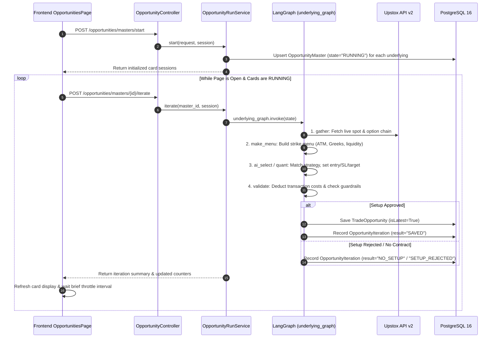
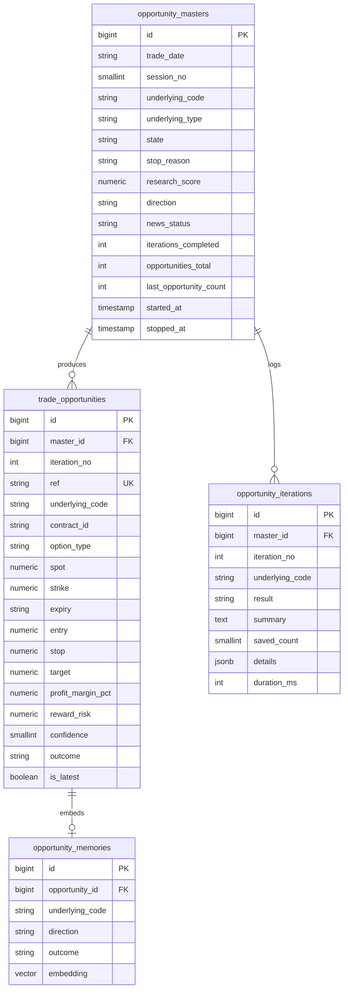

# 05. Opportunities Module (Real-Time Trade Scanner)

> **Document Type:** Domain Module Specification  
> **Module Path:** `backend-service/app/modules/opportunities/`  
> **Frontend Module:** `frontend/src/modules/opportunities/`  
> **Status:** Authoritative

---

## 1. Executive Overview

The **Opportunities Module** is Auto-Trader's real-time intraday trading scanner. It bridges macro sentiment and quantitative strategies with live market data from **Upstox API v2**.

The module operates on a **card session loop architecture**:
1. When the user clicks **Start Scanner** on the UI, an `OpportunityMaster` session card is initialized for each target underlying (e.g. NIFTY, BANKNIFTY, SENSEX, CRUDEOIL, GOLD).
2. The frontend continuously iterates running cards one by one via `POST /api/v1/opportunities/masters/{id}/iterate`.
3. Each iteration executes an asynchronous LangGraph decision workflow (`underlying_graph`), gathering live quotes, constructing an option strike menu, evaluating quantitative strategy rules, deducting realistic Indian transaction charges, and storing winning trade setups in `trade_opportunities`.
4. Detailed diagnostic events are recorded in `opportunity_iterations` for every batch—even when zero trades are found.
5. Saved opportunities are later read (never driven) by the **Trading Sessions** loop; see [10. Trading Sessions Module](10-sessions-module.md).

---

## 2. Card Session Architecture & Execution Loop



---

## 3. The 4-Node LangGraph Decision Graph

Each iteration of an active card executes `underlying_graph` (`builder.py`):


### Node Details:
1. **`gather`**:
   - Fetches live underlying spot price and OHLCV daily/intraday bars via `UpstoxMarketDataProvider`.
   - Computes intraday ATR, EMA(9), EMA(21), Supertrend, and VWAP.
   - Computes `DayContext`: trend direction, volatility regime, expiry day flag, and hour bucket ($0 \dots 6$).
   - Queries `OpportunityMemory` using `Vector(768)` embeddings to retrieve historical trades with similar technical patterns.
2. **`make_menu`**:
   - Queries the Upstox Option Chain for the nearest weekly/monthly expiry.
   - Filters strikes: selects At-The-Money (ATM), In-The-Money (ITM 1-2), and Out-of-The-Money (OTM 1-2).
   - Validates contract liquidity: requires minimum Open Interest (OI) and maximum bid-ask spread $< 1.5\%$.
3. **`ai_select`**:
   - Evaluates active strategy definitions (`RuleEvaluator`).
   - If Research clearance is `BULLISH` $\implies$ focuses on Call Options (CE).
   - If Research clearance is `BEARISH` $\implies$ focuses on Put Options (PE).
   - Calculates dynamic Entry Price, Stop Loss, and Profit Target using ATR multiples.
4. **`validate`**:
   - Calculates full Indian round-trip transaction costs via `costs.py`.
   - Rejects trade if expected net profit margin $< 4.0\%$ after all statutory taxes and brokerages.
   - Verifies risk-to-reward ratio ($\text{RRR} \ge 1.5$).
   - Verifies trading time window (e.g. blocks 15:15-15:30 intraday square-off rush).

---

## 4. Indian Option Transaction Costs Model (`costs.py`)

A unique strength of Auto-Trader's opportunity selector is its **exact post-tax cost modeling**. In Indian options trading, statutory taxes can consume 30% to 50% of the gross profit on low-priced option premiums.

```python
def round_trip_cost_pct(premium: float, lot_units: int, exchange: str, target_pct: float, brokerage_per_order: float = 20.0) -> float:
    buy = premium * lot_units
    sell = buy * (1 + target_pct / 100)
    turnover = buy + sell
    brokerage = 2 * brokerage_per_order                      # Rs 20 buy + Rs 20 sell
    exch = turnover * EXCHANGE_TXN.get(exchange, 0.0003503) # NSE ~0.03503%
    sebi = turnover * 1e-6                                  # Rs 10 per crore
    gst = 0.18 * (brokerage + exch + sebi)                  # 18% GST on fees
    stt = sell * STT_SELL.get(exchange, 0.001)              # 0.1% STT on SELL premium
    stamp = buy * 0.00003                                   # 0.003% Stamp duty on BUY
    total_charges = brokerage + exch + sebi + gst + stt + stamp
    return round((total_charges / buy) * 100, 2)
```

**Guardrail**: If `target_pct - cost_pct < MIN_NET_EDGE_PCT` (default $3.5\%$), the opportunity is discarded with code `COST_PROHIBITIVE`.

---

## 5. Vector Trade Memory (`memory_service.py`)

To prevent the algorithm from repeating trades that failed under similar macro or intraday conditions, the module maintains an experiential vector memory (`opportunity_memories`):
- When a trade opportunity resolves (`PROFIT` or `LOSS`), a textual fingerprint is constructed:
  > *"NIFTY LONG CE ATM on Trend Day during Hour 2 (11:00-12:00) with High ATR and Bullish Research clearance."*
- A 768-dimensional vector embedding is generated via `EmbeddingClient`.
- During subsequent `gather` runs, cosine similarity queries look for past trades with similarity $> 0.85$. If past identical setups consistently resolved in `LOSS`, the candidate is penalized or skipped.

---

## 6. Supported Underlyings Matrix (`underlying_config.py`)

| Symbol | Asset Type | Exchange | Lot Size | Strike Interval | Trading Hours |
|---|---|---|---|---|---|
| **NIFTY** | Index | NSE | 25 | 50.0 | 09:15 – 15:30 IST |
| **BANKNIFTY** | Index | NSE | 15 | 100.0 | 09:15 – 15:30 IST |
| **FINNIFTY** | Index | NSE | 25 | 50.0 | 09:15 – 15:30 IST |
| **MIDCPNIFTY**| Index | NSE | 50 | 25.0 | 09:15 – 15:30 IST |
| **SENSEX** | Index | BSE | 10 | 100.0 | 09:15 – 15:30 IST |
| **CRUDEOIL** | Commodity | MCX | 100 | 50.0 | 09:00 – 23:30 / 23:55 IST |
| **GOLD** | Commodity | MCX | 100 | 100.0 | 09:00 – 23:30 / 23:55 IST |
| **SILVER** | Commodity | MCX | 30 | 250.0 | 09:00 – 23:30 / 23:55 IST |
| **NATURALGAS**| Commodity | MCX | 1250 | 5.0 | 09:00 – 23:30 / 23:55 IST |

---

## 7. Database Schema & Entities



---

## 7b. Outcome Resolution, Duplicates & the Check

**One evaluator.** Outcomes (`TARGET_HIT`, `STOP_HIT`, `EXPIRED`) are decided **only** from Upstox **1-minute candles** (`_evaluate_opportunities` in `run_service.py`). There is no second path from LTP snapshots. Rules, chosen so a backtest never flatters the engine:

- Only bars that **open after the signal was created** count (`first_full_bar`): the bar holding `created_at` also holds prices from before the signal existed.
- A bar that touches **both** stop and target counts as a **STOP** (`first_touch`): the order inside a minute is unknown, so assume the worst.
- Bars at or after `valid_until` are ignored.
- The automatic pass after every iteration (`_resolve_pending`) resolves only rows that are still `PENDING`. The manual check endpoints use `rewrite=True`, which also corrects a stored outcome (or reverts it to `PENDING` if the candles do not support it).

**Duplicates.** A contract re-signalled within `DEDUPE_MINUTES = 30` of an earlier signal on the same contract is skipped. A live duplicate stays `is_latest` through `replace_latest(keep_ids)`, so it is not wiped by the next batch.

**Expiry day.** The engine drops the expiring contract after 13:30 IST on expiry day (`EXPIRY_GAMMA_CUTOFF`), so only the next expiry is offered; the menu lists the CURRENT and NEXT expiry chains.

**Check (is the strategy working?).** `POST /opportunities/{id}/check` replays one saved opportunity on the candles; `POST /opportunities/masters/{id}/check` does the same for a batch. Each result returns `outcome`, `achievedPct` (progress toward the target, 100 = hit), `pnlPct`, `pnlPoints`, `exitPrice`, `peakPrice`, `troughPrice`, `maxGainPct`, `hitAt`, `candlesChecked` and `windowEnded`. The UI shows it as a **Check** button with an inline verdict (no chart view). `scripts/opportunity_pnl_report.py` uses the same evaluator with `rewrite=True` to produce day P&L reports.

---

## 8. REST API Endpoints (`opportunity_router`)

All endpoints are registered under `/api/v1/opportunities`:

| Method | Endpoint | Description |
|---|---|---|
| `POST` | `/api/v1/opportunities/masters/today` | Fetch active card sessions for today's market date |
| `POST` | `/api/v1/opportunities/masters/start` | Initialize card sessions for today's target underlyings |
| `POST` | `/api/v1/opportunities/masters/{id}/iterate` | Execute one LangGraph iteration cycle on a specific card session |
| `POST` | `/api/v1/opportunities/masters/{id}/stop` | Stop scanning on an individual card session |
| `POST` | `/api/v1/opportunities/masters/stop-all` | Emergency stop all active card sessions across all underlyings |
| `POST` | `/api/v1/opportunities/masters/{id}/check` | Replay a batch (or all batches) of a card on 1-minute candles: outcome, achieved %, P&L |
| `POST` | `/api/v1/opportunities/{id}/check` | Replay one opportunity on 1-minute candles (same result fields) |
| `POST` | `/api/v1/opportunities/search` | Search and paginate historical trade opportunities (`BaseFilter`) |
| `POST` | `/api/v1/opportunities/iterations/search` | Query diagnostic execution logs for underlying iterations |
| `GET` | `/api/v1/opportunities/latest` | Retrieve the latest active trade opportunity per underlying |

