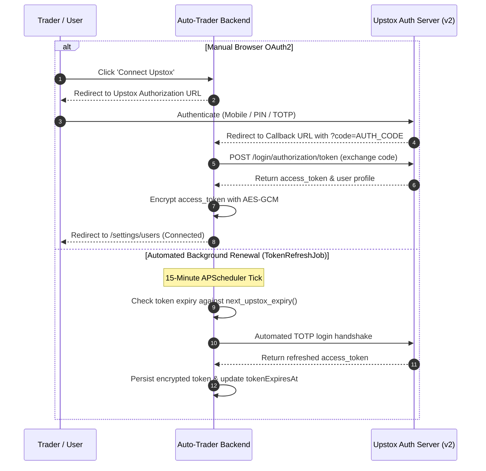
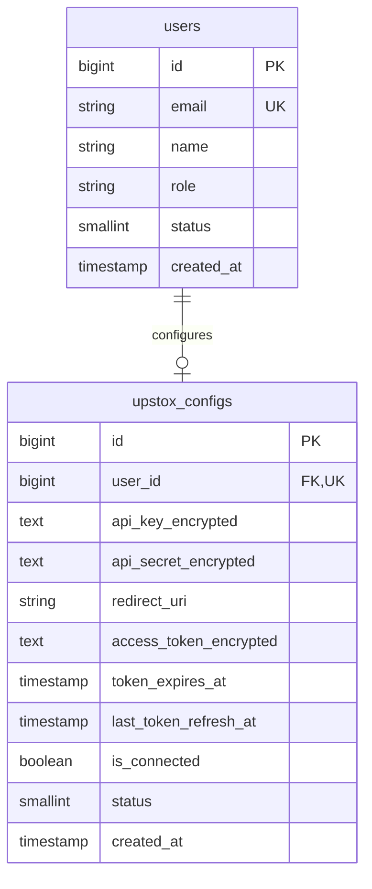

# 06. Users & Broker Module (Upstox Authentication & Credential Vault)

> **Document Type:** Domain Module Specification  
> **Module Path:** `backend-service/app/modules/users/`  
> **Frontend Module:** `frontend/src/modules/users/`  
> **Status:** Authoritative

---

## 1. Executive Overview

The **Users & Broker Module** manages user profiles, broker accounts, and authenticated communication with **Upstox API v2**.

Broker integrations in Indian financial markets require handling strict regulatory constraints:
- Upstox access tokens are transient and **expire daily at 03:30 IST**, irrespective of the issue timestamp.
- User secrets (`apiKey`, `apiSecret`, TOTP seed, and OAuth tokens) must be securely encrypted at rest using AES-GCM 256-bit cryptography.
- Auto-Trader features an automated background token renewal daemon that re-authenticates broker sessions before the 09:00 MCX / 09:15 NSE market openings without requiring manual user intervention.

---

## 2. Broker Security & Encryption Vault

Sensitive credentials are encrypted in PostgreSQL using `SecretCipher`:

```mermaid
graph LR
    subgraph Browser ["Frontend (Browser)"]
        UI_Form["Users Settings Form<br/>(apiKey, apiSecret, TOTP)"]
    end

    subgraph Backend ["Backend User Module"]
        API_Ctrl["UserController (HTTPS)"]
        Cipher["SecretCipher (AES-GCM 256)"]
        VaultKey["APP_MASTER_ENCRYPTION_KEY"]
    end

    subgraph Database ["PostgreSQL (upstox_configs)"]
        Col_Key["api_key_encrypted (Base64)"]
        Col_Secret["api_secret_encrypted (Base64)"]
        Col_Token["access_token_encrypted (Base64)"]
    end

    UI_Form -->|POST (TLS 1.3)| API_Ctrl
    API_Ctrl --> Cipher
    VaultKey --> Cipher
    Cipher -->|Ciphertext + Nonce + Tag| Database
```

### Security Rules:
- Plaintext secrets are **never** logged to terminal or files.
- The `ApiResponse` schemas for user and broker profiles strictly mask sensitive attributes (`apiKey: "••••••••abcd"`, `isConnected: true`).
- Decryption occurs only in memory when preparing an authenticated HTTP request to Upstox.

---

## 3. Upstox OAuth2 & Automated Zero-Touch Handshake

Auto-Trader supports both standard browser-based OAuth2 redirection and automated zero-touch TOTP authentication:



### 3.1 Token Expiry Calculation (`next_upstox_expiry`)
```python
def next_upstox_expiry(now: datetime) -> datetime:
    """Upstox access tokens expire at 03:30 IST the next morning, whatever time they were issued."""
    local = now.astimezone(_IST)
    cutoff = datetime.combine(local.date(), dtime(3, 30), tzinfo=_IST)
    if local >= cutoff:
        cutoff += timedelta(days=1)
    return cutoff.astimezone(UTC)
```

---

## 4. Automated Token Refresh Daemon (`token_refresh_job.py`)

A background scheduled task runs on the single Uvicorn worker:
- **Schedule**: Every 15 minutes (`interval`, `minutes=15`).
- **Initial Run**: 20 seconds after application startup.
- **Renewal Criteria**: Renews tokens that are missing, already expired, or expiring within 30 minutes.
- **Market Protection**: Because Upstox invalidates tokens at 03:30 IST, the daemon's first run post-03:30 renews tokens well before the 09:00 MCX commodity open and the 09:15 NSE equity open, ensuring uninterrupted algorithmic execution.

---

## 5. Live Account & Funds Synchronization

When connected, the service pulls live portfolio and account metrics via `UpstoxService`:
- **User Profile**: Client ID, name, email, user type, broker status.
- **Fund Balances**: Available margin, used margin, cash balance, collateral margin.
- **Trading Segments**: Checks active permissions for `NSE_INDEX`, `NSE_FO`, `BSE_INDEX`, `BSE_FO`, and `MCX_FO`.

---

## 6. Database Schema & Entities



---

## 7. REST API Endpoints (`user_router`, `oauth_router`)

All endpoints are registered under `/api/v1/users` and `/api/v1/oauth`:

| Method | Endpoint | Description |
|---|---|---|
| `POST` | `/api/v1/users` | Register a new user |
| `POST` | `/api/v1/users/search` | Search and paginate users (`BaseFilter`) |
| `GET` | `/api/v1/users/{id}` | Get user details and linked Upstox connection status |
| `PUT` | `/api/v1/users/{id}` | Update user name and profile info |
| `DELETE` | `/api/v1/users/{id}` | Soft-delete user |
| `POST` | `/api/v1/users/{id}/upstox-config` | Save or update encrypted Upstox API credentials |
| `GET` | `/api/v1/users/{id}/upstox/funds` | Fetch live available cash, used margin, and collateral |
| `GET` | `/api/v1/users/{id}/upstox/profile` | Fetch Upstox broker profile and active market segments |
| `POST` | `/api/v1/users/{id}/upstox/refresh-token` | Force manual re-authentication and token renewal |
| `GET` | `/api/v1/oauth/upstox/login-url` | Generate browser authorization redirect URL |
| `GET` | `/api/v1/oauth/upstox/callback` | OAuth2 callback endpoint exchanging code for token |

