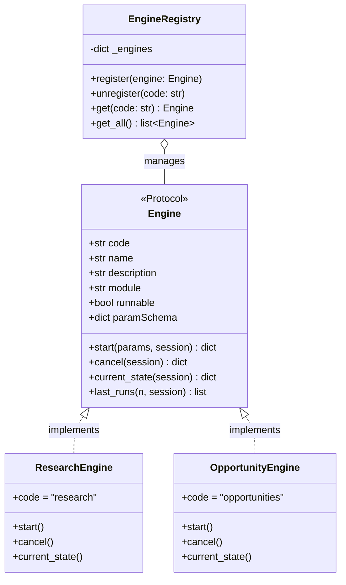
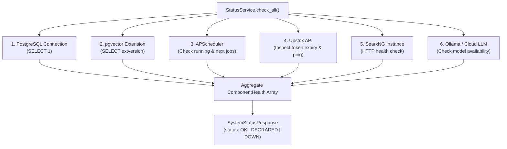

# 07. System & Runtime Module (Engine Registry & Diagnostics)

> **Document Type:** Domain Module Specification  
> **Module Path:** `backend-service/app/modules/system/`  
> **Status:** Authoritative

---

## 1. Executive Overview

The **System & Runtime Module** provides centralized operational awareness, runtime engine lifecycle management, and platform-wide health monitoring for Auto-Trader.

It serves two primary functions:
1. **Decoupled Execution Engine Registry (`EngineRegistry`)**: A protocol-driven registry allowing independent background engines (such as the 14-step Research Engine and the Real-Time Opportunities Scanner) to register their capabilities, runtime schemas, and lifecycle control hooks without tight coupling to the web framework.
2. **Deep Diagnostic Health Service (`StatusService`)**: Performs multi-point system checks across PostgreSQL, the `pgvector` extension, the APScheduler runtime, and external upstream APIs (Upstox, SearxNG, Ollama).

---

## 2. Decoupled Engine Architecture (`EngineRegistry`)

### 2.1 The `Engine` Protocol
Every execution engine conforms to the Python `Protocol` defined in `engine_registry.py`:
- `code`: Unique identifier (`"research"`, `"opportunities"`).
- `name` & `description`: Human-readable summary for dashboards.
- `runnable`: Boolean indicating whether manual trigger is supported.
- `paramSchema`: JSON Schema of parameters accepted by `start()`.
- `start(params, session)`: Asynchronously starts execution.
- `cancel(session)`: Interrupts or gracefully terminates active runs.
- `current_state(session)`: Returns real-time execution state (`RUNNING`, `IDLE`, `CANCELLED`, `ERROR`), current node name, progress percentage, and operational statistics.
- `last_runs(n, session)`: Retrieves historical execution logs.

---

## 3. Deep System Health Service (`StatusService`)

`StatusService.check_all(session)` runs synchronous and asynchronous probes across the platform stack:

### 3.2 Health Status Evaluation
- `OK`: All critical systems (Database, `pgvector`, Scheduler) are fully functional.
- `DEGRADED`: Non-fatal auxiliary service down (e.g. SearxNG offline, but cached articles available; or Upstox token expiring in 10 minutes).
- `DOWN`: Critical component failure (Database unreachable or scheduler crashed).

---

## 4. REST API Endpoints (`system_router`)

All endpoints are registered under `/api/v1/system`:

| Method | Endpoint | Description |
|---|---|---|
| `GET` | `/api/v1/system/status` | Deep diagnostic health check across database, vector store, and broker |
| `GET` | `/api/v1/system/engines` | List all registered execution engines, descriptions, and run schemas |
| `GET` | `/api/v1/system/engines/{code}` | Get runtime state, progress percentage, and stats for an engine |
| `POST` | `/api/v1/system/engines/{code}/start` | Start execution of an engine with custom parameters |
| `POST` | `/api/v1/system/engines/{code}/cancel` | Cancel active execution of an engine |
| `POST` | `/api/v1/system/engines/search` | Search and paginate historical engine runs (`BaseFilter`) |

