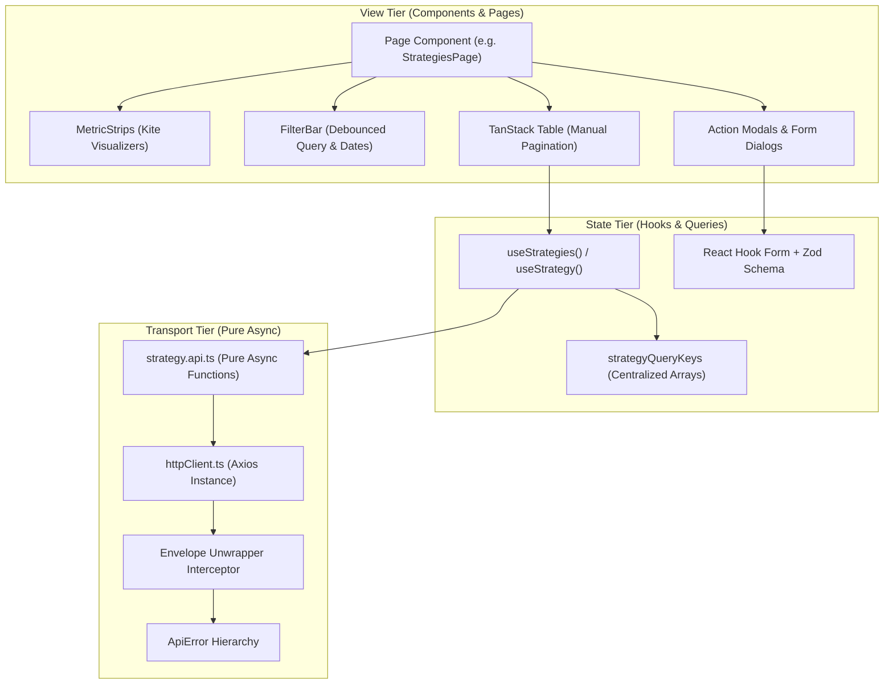

# 08. Frontend Architecture & User Interface Systems

> **Document Type:** Frontend Architecture Specification  
> **Directory Path:** `frontend/src/`  
> **Status:** Authoritative

---

## 1. Executive Overview

The **Auto-Trader Frontend** is a high-performance single-page application (SPA) engineered with **React 19**, **Vite**, and **TypeScript**. It provides institutional-grade trading visualizations, visual rule builders, interactive proposal review cards, real-time opportunity session cards, and broker fund management.

The frontend strictly enforces:
- **Zero-Casing Conversion**: API responses are delivered in `camelCase` and consumed directly by TypeScript interfaces without mapping or translation layers.
- **Kite / Eye-Comfort Pro Trading Dark Palette**: Uniform dark-mode visual hierarchy styled after professional Indian financial terminals (Zerodha Kite) with monospace numerical displays and accessible contrast ratios.
- **Strict One-Way Component Hierarchy**:
  $$\text{Component} \longrightarrow \text{Custom Hook} \longrightarrow \text{API Function} \longrightarrow \text{httpClient (Axios)}$$
- **Automatic Envelope Unwrapping**: Axios automatically unwraps `response.data.data` and raises structured `ApiError` instances on non-2xx status codes.

---

## 2. Technology Matrix & Component Hierarchy

| Layer | Library / Tool | Implementation Details |
|---|---|---|
| **Framework & Compiler** | React 19, TypeScript 5+, Vite | Strict mode, JSX transform, zero runtime polyfills |
| **Routing** | TanStack Router v1 | Type-safe path params (`$id`), search validation via Zod schemas |
| **Server State** | TanStack Query v5 | Key factories, `placeholderData: keepPreviousData`, automatic cache invalidation |
| **Tables** | TanStack Table v8 | Manual server-side pagination, sorting, column visibility |
| **Form Handling** | React Hook Form + Zod | Schema-driven validation, server-side field error mappings |
| **HTTP Transport** | Axios | Custom interceptors unwrapping `ApiResponse[T]` envelope |
| **Icons & Styling** | Lucide React, Tailwind CSS | Eye-comfort financial theme variables |



---

## 3. Eye-Comfort Pro Trading Dark Palette (`index.css`)

All visual styling adheres to the custom palette configured in `frontend/src/index.css`:

```css
:root {
  --bg-primary: #12151a;       /* Deep slate terminal background */
  --bg-card: #181c24;          /* Card and table row background */
  --bg-subtle: #202632;        /* Input, hover, and chip background */
  --border-subtle: #283040;    /* Thin boundary borders */
  
  --text-primary: #e1e7ec;     /* High-legibility text */
  --text-muted: #8492a6;       /* Subtext and parameter labels */
  
  --bullish-green: #00d09c;    /* Zerodha Kite bullish call accent */
  --bearish-red: #eb5757;      /* Zerodha Kite bearish put accent */
  --accent-blue: #387ed1;      /* Action button and link color */
  --warning-amber: #f7931a;    /* Quarantine and warning pills */
  
  --font-mono: ui-monospace, SFMono-Regular, Menlo, Monaco, Consolas, monospace;
}
```

### Visual Standards:
- All numerical metrics (prices, strikes, PnL percentages, Greeks, token counts) must use `--font-mono`.
- Financial gains use `--bullish-green`; losses use `--bearish-red`. Quarantined items use `--warning-amber`.
- Purple or neon gradients are strictly prohibited.

---

## 4. Routing Architecture (`app/router/router.tsx`)

The client route tree is configured using `@tanstack/react-router`:

```text
/ (Index)                 ──► Redirects to /strategies
/strategies               ──► StrategiesPage (List, Filters, Metrics)
/strategies/create        ──► StrategyEditorPage (Rule Builder)
/strategies/:id           ──► StrategyDetailPage (AST, Backtest, Health Diagnostics)
/strategies/:id/edit      ──► StrategyEditorPage (Edit Mode)
/rules                    ──► RulesPage (Reusable Rule Registry)
/master                   ──► MasterPage (LangGraph AI Chat & Proposals)
/research                 ──► ResearchEnginePage (Market Intelligence & News)
/opportunities            ──► OpportunitiesPage (Live Session Cards & Iterations)
/opportunities/:id/detail ──► OpportunityDetailPage (Deep Iteration Logs)
/settings/users           ──► UsersPage (Broker OAuth & Funds)
```

### Search Validation with Zod:
For tabbed screens (such as Opportunities), query parameters are validated via Zod:
```typescript
const opportunitiesRoute = createRoute({
  getParentRoute: () => rootRoute,
  path: "/opportunities",
  validateSearch: z.object({
    tab: z.enum(["INDEX", "COMMODITY"]).optional(),
    card: z.string().optional(),
  }),
  component: OpportunitiesPage,
});
```

---

## 5. Server State & TanStack Query Standards

### 5.1 Query Key Factories
Inline key arrays (e.g. `['strategies', filter]`) are prohibited. Every module exports a dedicated query key factory:

```typescript
// strategyQueryKeys.ts
export const strategyQueryKeys = {
  all: ["strategies"] as const,
  lists: () => [...strategyQueryKeys.all, "list"] as const,
  list: (filter: StrategyFilter) => [...strategyQueryKeys.lists(), filter] as const,
  details: () => [...strategyQueryKeys.all, "detail"] as const,
  detail: (id: number) => [...strategyQueryKeys.details(), id] as const,
  diagnostics: (id: number) => [...strategyQueryKeys.detail(id), "diagnostics"] as const,
};
```

### 5.2 Cache Invalidation & `keepPreviousData`
- Search queries use `placeholderData: keepPreviousData` to prevent layout jumps during pagination or debounced query typing.
- Mutations invalidate associated key families upon success:
  ```typescript
  const queryClient = useQueryClient();
  const mutation = useMutation({
    mutationFn: updateStrategy,
    onSuccess: (data) => {
      queryClient.invalidateQueries({ queryKey: strategyQueryKeys.lists() });
      queryClient.invalidateQueries({ queryKey: strategyQueryKeys.detail(data.id) });
    },
  });
  ```

---

## 6. HTTP Client & Envelope Unwrapping (`httpClient.ts`)

The centralized Axios client transparently unwraps backend envelopes:
1. When the backend returns `{ statusCode: 200, data: { ... }, message: "..." }`, the interceptor extracts and returns `data` directly to the calling function.
2. If the response contains a non-2xx status code or error payload, it throws an `ApiError`:
   ```typescript
   export class ApiError extends Error {
     constructor(
       public statusCode: number,
       public message: string,
       public error: any = null
     ) {
       super(message);
     }
   }
   ```
3. Form components catch `ApiError` instances and map `error` arrays (`[{ field, message }]`) directly onto React Hook Form fields via `setError()`.

---

## 7. Module Screen Walkthroughs

### 7.1 Strategies & Rules UI (`modules/strategies`)
- **Executive Metric Strip**: Displays Total Strategies, Active Strategies, Quarantined Count, Average Win Rate, and Average Reliability Score.
- **Strategies Table**: Manual pagination table with columns for Code, Name, Direction (LONG/SHORT pill), Timeframe, Version, Reliability Score progress bar, Status pill (`ACTIVE`, `QUARANTINED`, `DRAFT`), and Quick Actions.
- **Strategy Detail**: Interactive visual tree of the compiled rule AST, indicator parameter list, backtest trigger button, and quarantine toggle.

### 7.2 AI Master Chat UI (`modules/master`)
- **Interactive Chat Thread**: User and Assistant message sequence with markdown rendering.
- **Tool Execution Timeline**: Expandable micro-panels showing which FastMCP tools the agent called in the background (e.g. `validate_strategy`, `analyze_conflicts`).
- **Interactive Proposal Review Card**:
  - Displays proposed strategy name, symbol, and direction.
  - Interactive rule diff viewer highlighting added or modified conditions.
  - Plain-English back-translated summary.
  - Severity-tagged complications (Blockers, Warnings, Info).
  - One-click **Approve & Deploy** or **Reject** action buttons.

### 7.3 Research Engine UI (`modules/research`)
- **Scope Toggle**: Switch between `INDEX` (NIFTY, BANKNIFTY, SENSEX) and `COMMODITY` (GOLD, CRUDEOIL, SILVER).
- **Candidate Intelligence Cards**:
  - Clearance badge (`CLEAR`, `WATCH`, `BLOCKED`).
  - Circular opportunity score meter ($0 \dots 100$).
  - Bullish vs. Bearish sentiment weight bar.
  - Factual claim counts and independent publisher coverage count.
  - Expandable **Daily Intelligence Brief** containing the synthesized market thesis and catalyst news citations.

### 7.4 Opportunities Scanner UI (`modules/opportunities`)
- **Live Card Session Grid**: One card per underlying. Displays current scanning state (`RUNNING` or `STOPPED`), completed iteration count, top confidence score, and stop reason.
- **Master Action Bar**: **Start All** and **Emergency Stop All** buttons.
- **Active Trade Opportunity Card**:
  - Contract specification (e.g. `NIFTY 23500 CE 28-OCT`).
  - Spot price, entry limit, stop-loss, and profit target with visual risk-reward ratio bar.
  - Estimated round-trip statutory costs percentage.
  - Valid-until timer countdown.
- **Diagnostics Log**: Step-by-step audit log of every iteration cycle showing why setups were accepted or rejected (`SAVED`, `NO_SETUP`, `SETUP_REJECTED`, `COST_PROHIBITIVE`).

