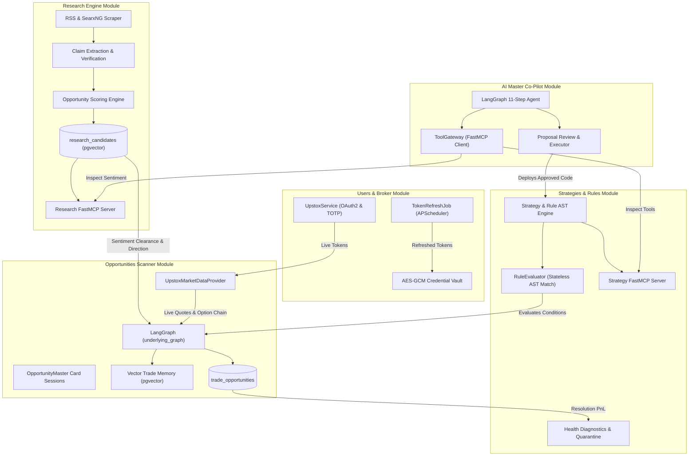
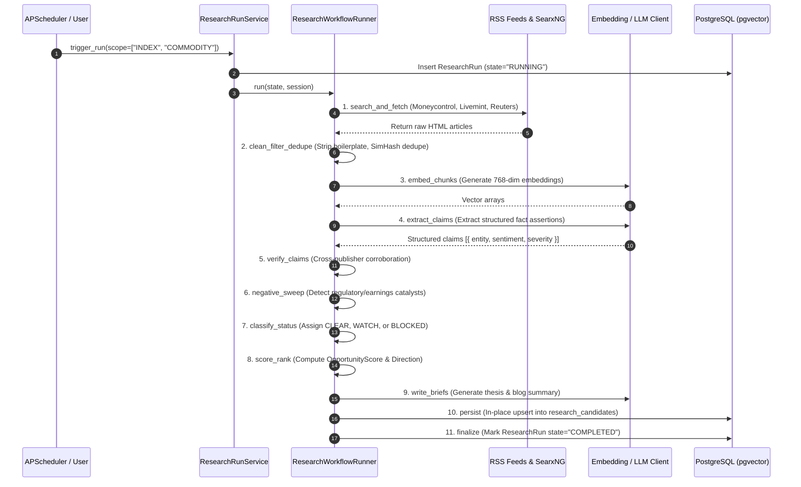
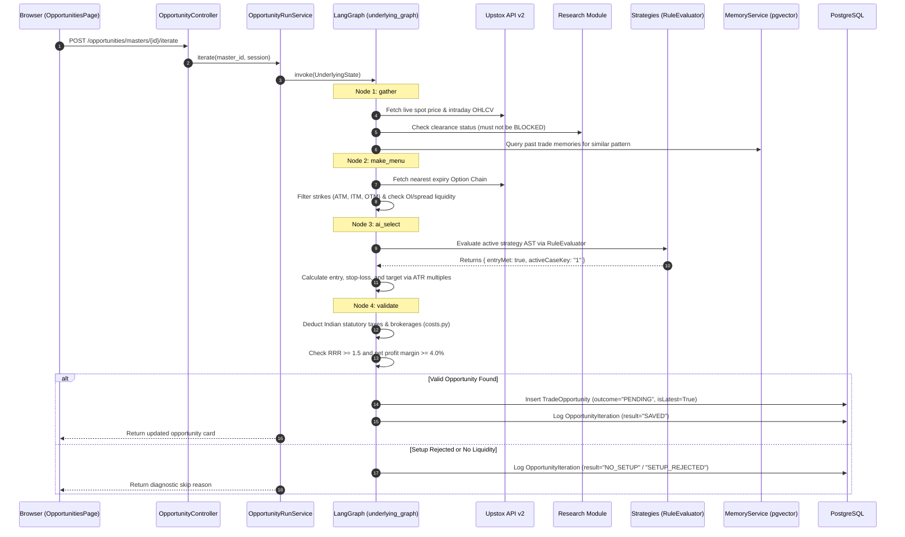
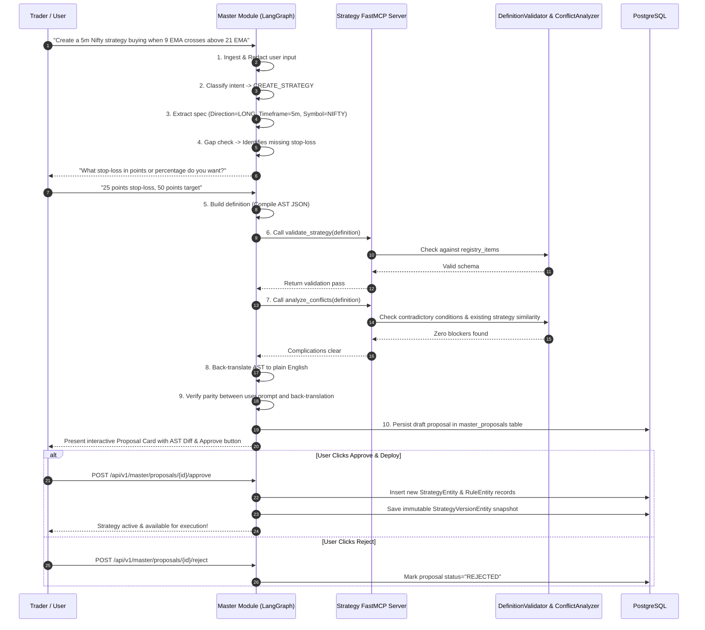
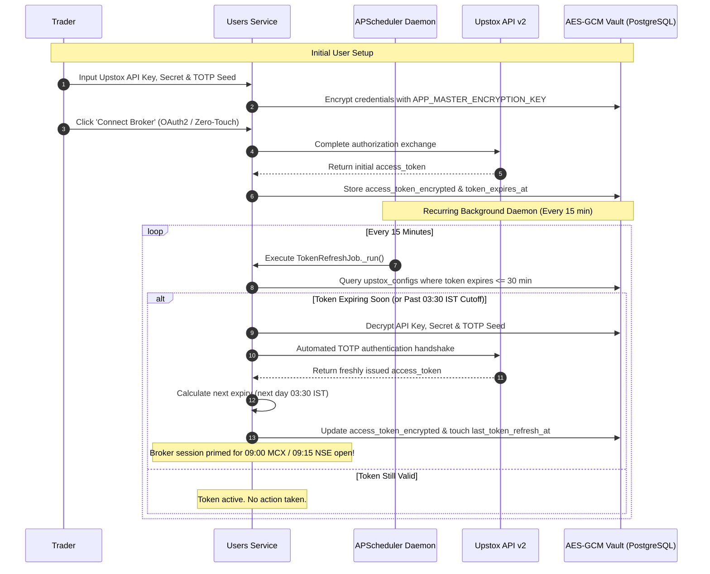
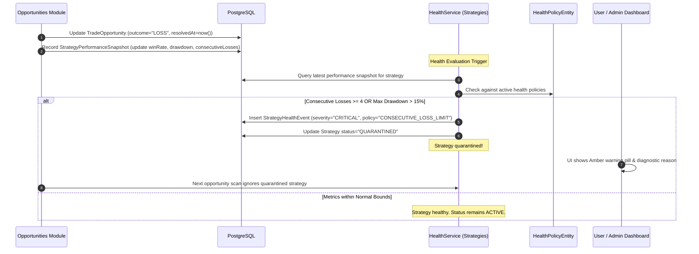
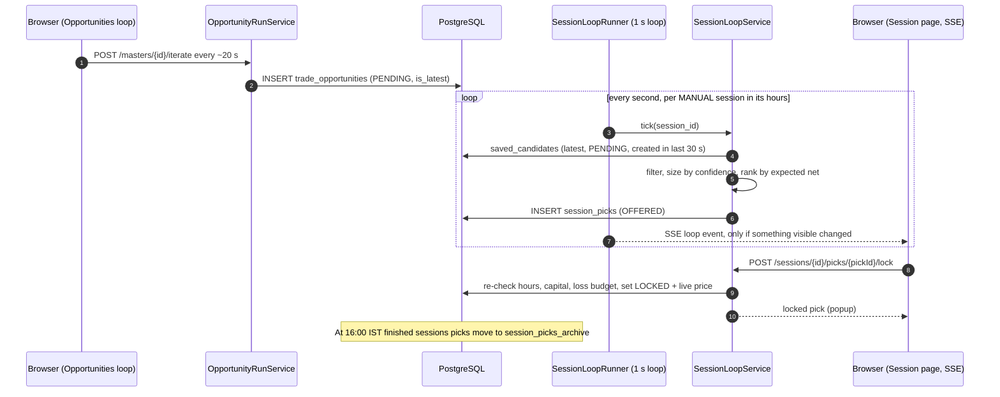

# 09. Inter-Module Connections & End-to-End Data Flows

> **Document Type:** System Integration Specification  
> **Status:** Authoritative  
> **Repository:** `auto-trader`

---

## 1. Executive Summary

The strength of **Auto-Trader** lies in the deterministic coordination of its domain modules. Rather than operating in isolated silos, the platform connects macro sentiment intelligence, quantitative rule ASTs, real-time market data, broker credentials, and conversational AI co-pilots into unified execution pipelines.

This specification documents the **core end-to-end data flows** that power the platform (the five numbered below, plus the session loop in section 7b):
1. **Autonomous Market Intelligence Flow** (`research` $\longrightarrow$ `pgvector` $\longrightarrow$ `opportunities`)
2. **Real-Time Trade Opportunity Discovery Flow** (`Upstox API` $\longrightarrow$ `research` $\longrightarrow$ `strategies` $\longrightarrow$ `opportunities`)
3. **Conversational Strategy Creation Flow** (`master` $\longleftrightarrow$ `FastMCP` $\longleftrightarrow$ `strategies`)
4. **Broker Authentication & Token Renewal Lifecycle** (`users` $\longleftrightarrow$ `APScheduler` $\longleftrightarrow$ `Upstox API`)
5. **Automated Strategy Health & Quarantine Flow** (`opportunities` $\longrightarrow$ `strategies` $\longrightarrow$ `health`)

---

## 2. End-to-End System Integration Matrix



---

## 3. Flow 1: Autonomous Market Intelligence Pipeline

**Purpose:** Continuously aggregates news, extracts verifiable claims, and establishes sentiment clearance so trading strategies never enter long positions on compromised underlyings.



---

## 4. Flow 2: Real-Time Trade Opportunity Discovery Pipeline

**Purpose:** Continuously scans live option chains, matches quantitative strategy rules, checks vector memory, and emits executable intraday trades.



---

## 5. Flow 3: Conversational Strategy Generation Pipeline

**Purpose:** Converts natural language trading ideas into mathematically validated, conflict-free quantitative strategies via the AI Master and FastMCP.



---

## 6. Flow 4: Broker Authentication & Token Renewal Lifecycle

**Purpose:** Ensures uninterrupted connectivity with Upstox by renewing transient access tokens before daily market open sessions.



---

## 7. Flow 5: Automated Health Diagnostics & Quarantine Flow

**Purpose:** Automatically detects degraded strategy performance and quarantines underperforming models to prevent capital erosion.



---

## 7b. Session Loop: From a Saved Opportunity to Trade Lock

**Purpose:** Turns opportunities the engine has already saved into a ranked, capital-sized table of trades to take for one trading session, pushed live to the browser. Full specification: [10. Trading Sessions Module](10-sessions-module.md).



The two loops are decoupled: the session only reads `trade_opportunities`, so it shows new trades only while the Opportunities loop is fetching.

---

## 8. Cross-Cutting Event Bus Pub/Sub Flows

In addition to direct service-to-service calls, Auto-Trader utilizes `app.core.events.event_bus` for asynchronous event broadcasting:

```mermaid
graph LR
    Publisher["Event Publisher"] -->|publish(event_type, payload)| Bus["In-Memory Async EventBus"]
    
    Bus -->|run.started| Sub1["Audit & Traffic Logger"]
    Bus -->|proposal.approved| Sub2["Strategy Versioning Snapshotter"]
    Bus -->|strategy.quarantined| Sub3["Alert Notification Handler"]
    Bus -->|opportunity.resolved| Sub4["Trade Memory Vectorizer"]
```

### Event Naming Conventions:
- `<module>.<entity>.<action>` (e.g. `strategies.strategy.quarantined`, `opportunities.trade.resolved`, `master.run.started`).
- Event handlers are asynchronous and execute concurrently via `asyncio.gather(*tasks, return_exceptions=True)`.

