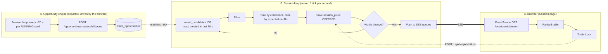

# 10. Trading Sessions Module (`sessions`)

> **Document Type:** Module Specification
> **Status:** Authoritative
> **Module path:** `backend-service/app/modules/sessions`, `frontend/src/modules/sessions`

---

## 1. Executive Overview

A **trading session** is the capital / risk / scope / hours envelope a trader sets up for one trading day. A **MANUAL** session runs a **server-side loop** that turns the opportunities the engine has already saved into a ranked table of **trades to take**, sized to the session's own capital and loss budget, and pushes that table to the browser over **SSE**. The trader presses **Trade Lock** on a row.

Key rules:

- The session loop **never runs or listens to the opportunity engine**. It only reads `trade_opportunities` (a plain indexed read). Opportunities are produced separately by the Opportunities module (see [05](05-opportunities-module.md)); the two are linked only through that table.
- The loop is a plain `asyncio` task (`while True: tick; sleep`), **not** a scheduler job.
- Nothing here places an order. **Trade Lock** records the lock and the live premium; execution is a later phase.
- Only `sessionType = MANUAL` runs the loop. `SEMI_AUTO` / `FULL_AUTO` report `UNSUPPORTED_TYPE`.

---

## 2. Data Model

| Table | Purpose |
|---|---|
| `trading_sessions` | The session envelope (below). |
| `session_picks` | **Live** table: one row per opportunity offered to a session, for sessions still in their trading hours. Read every second by the loop. |
| `session_picks_archive` | Same columns plus `archived_at`. Picks of finished sessions are moved here every day (section 8). |

`trading_sessions` main columns: `name`, `trade_date` (IST `YYYY-MM-DD`), `user_id`, `capital`, `max_loss_percentage` (default 3), `scope` (`INDEX` / `COMMODITY`), `underlyings`, `commodity_items`, `session_type`, `route_through_upstox` (false = simulated), `realized_pnl`, `session_status` (`ACTIVE` / `CLOSED` / `EXPIRED`), `start_at`, `close_at`, `halt_reason`, `halted_at`, `closed_at`. `status` is the soft-delete flag and is unrelated to `session_status`.

`session_picks` is a **snapshot** of an opportunity sized for the session: `opportunity_id` / `opportunity_ref` (the link back), contract, `entry`, `entry_max`, `stop`, `target`, `lots`, `quantity`, `capital_required`, `risk_amount`, `reward_amount`, `expected_net`, `capital_at_pick`, `available_at_pick`, `reasons`, `risks`, timestamps (`signal_at`, `hold_until`, `offered_at`, `expires_at`, `locked_at`) and `locked_price`.

- A unique index `(session_id, opportunity_id)` means an opportunity is offered to a session **once**.
- The engine's batch number (`iteration_no`) is **not** copied; the link back is `opportunity_id`.
- Items that fail the session's checks are **not saved**. They are only counted in the live state (`scanned.excluded`, in memory).

`pickState`: `OFFERED` → `LOCKED` (trader pressed Trade Lock) or `EXPIRED` (the opportunity expired first, or the session closed).

---

## 3. Trading Hours

Every session has `start_at` and `close_at` (stored UTC, entered as `HH:MM` IST on the trade date). Logic lives in `service/session_hours.py`.

| Field | Default |
|---|---|
| **Start** | **Now** (whole minute) if the session is created for today at or after **09:25 IST**; otherwise **09:15** (market open) on its date |
| **Close** | **15:45 IST** |

The create form pre-fills both values; the trader can change them. Close must be after start (HTTP 400 otherwise, for example when creating a session after 15:45 with the default close).

Behaviour of the loop:

- **Before `start_at`**: state `SCHEDULED` ("Starts at 09:15 IST"), nothing offered. The loop task already exists; it just idles.
- **At `close_at`**: the tick sets `session_status = CLOSED`, `closed_at`, expires open `OFFERED` picks and returns `SESSION_CLOSED`; the loop task ends. Locked picks stay locked.
- **Trade Lock after `close_at`** is refused with `SESSION_HOURS_OVER`.

Migration `0018_session_hours` gave existing sessions 09:15 to 15:45 on their trade date.

---

## 4. The Session Loop

### 4.1 Lifecycle (`engine/session_loop_runner.py`)

- One `asyncio` task per eligible session (`ACTIVE`, `MANUAL`, `trade_date` = today, not deleted).
- Started by `POST /sessions` (and by `PUT` when type / status / date change) via `runner.sync(session)`; stopped on close or delete.
- On backend startup `resume_today()` restarts the loop of every eligible session (loops die with the process).
- Tick every **1 s**; after an unexpected error it backs off **3 s**. The task ends on `SESSION_CLOSED` or `UNSUPPORTED_TYPE`.
- Single uvicorn worker, so the latest snapshot and the SSE subscriber queues live in memory.

### 4.2 One tick (`service/session_loop_service.py`)

1. Expire `OFFERED` picks whose `expires_at` has passed.
2. Gates, in order: session not `ACTIVE` or not today → `SESSION_CLOSED`; past `close_at` → close the session; not `MANUAL` → `UNSUPPORTED_TYPE`; before `start_at` → `SCHEDULED`; realised loss at the limit → `HALTED` (`halt_reason = MAX_LOSS`).
3. Re-fit open offers to the capital free **now** (another lock may have used the money); drop those that no longer fit.
4. `saved_candidates()` (Opportunities service): latest, `PENDING`, not past `valid_until`, created in the last **30 s**, for the session's underlyings. Each item carries `instrumentKey`, `exchange`, `lotUnits`.
5. Per candidate: skip if already offered, expires in under **8 s**, levels invalid, fit fails (loss budget below 1 lot / not enough free capital), or the edge after charges is not positive.
6. Size and rank (section 5), save the best as `OFFERED` rows up to **10 open offers** (a display cap, not a trade limit).
7. Return the snapshot: `PICK_READY` or `WAITING`.

An offer **stays open until the opportunity behind it expires** (`expires_at = valid_until`) or it is locked. There is no fixed offer window.

### 4.3 Sizing (`service/session_sizing.py`)

There is **no trade-count limit**; only money caps:

- Free capital = current capital (capital + realised P&L) minus premium committed to `LOCKED` picks.
- Loss budget = `capital × max_loss_percentage` minus realised loss minus worst-case loss of `LOCKED` picks.
- **Lots** = 1 at a win probability (= confidence) of 50% or less, rising linearly to the maximum the free cash and the loss budget allow at 100%.
- **Entry area**: `entry` up to `entry_max`, the highest price at which reward:risk is still at least **1.2**; the trader must not chase above it.
- **Rank**: expected net rupees, then confidence, then reward:risk, then newest.

---

## 5. Live Updates (SSE)

`GET /api/v1/sessions/{id}/stream` (`text/event-stream`):

| Event | When |
|---|---|
| `loop` | On connect (newest state), then whenever something visible changed. Payload = `SessionLoopResponse` (`state`, `message`, `picks`, `capital`, `scanned`) |
| `heartbeat` | Every 10 s, carries `serverTime` |
| `closed` | The loop ended; the client stops reconnecting |

Change detection ignores the clocks, so an idle table sends nothing. The browser (`useSessionLoop`) keeps a clock offset from `serverTime` and computes any countdown from `expiresAt`. `EventSource` reconnects by itself and the server re-sends the current state.

Loop states: `SCHEDULED`, `PICK_READY`, `WAITING`, `HALTED`, `SESSION_CLOSED`, `UNSUPPORTED_TYPE`.

---

## 6. Trade Lock

`POST /api/v1/sessions/{id}/picks/{pickId}/lock`. Under a per-session lock the server checks:

| Check | Error code (HTTP 409) |
|---|---|
| Pick is still `OFFERED` | `PICK_NOT_OFFERED` |
| Its opportunity has not expired | `PICK_EXPIRED` |
| Session is `ACTIVE` | `SESSION_NOT_ACTIVE` |
| Within trading hours | `SESSION_HOURS_OVER` |
| Loss limit not reached | `HALTED` |
| Free capital covers the premium | `INSUFFICIENT_CAPITAL` |
| Remaining loss budget covers the risk | `LOSS_BUDGET` |

On success the pick becomes `LOCKED`, `locked_at` is set and `locked_price` is the live premium (a missing quote never blocks the lock). Locking an already locked pick is idempotent. The locked premium and risk then reduce what the next tick can offer.

---

## 7. REST API (`/api/v1/sessions`)

| Method | Endpoint | Description |
|---|---|---|
| `POST` | `/sessions` | Create a session (optional `startTime` / `closeTime` as `HH:MM` IST) and start its loop |
| `POST` | `/sessions/search` | Paged search (`TradingSessionSearchFilter`) |
| `GET` | `/sessions/{id}` | One session, with the newest loop snapshot in `loop` |
| `PUT` | `/sessions/{id}` | Update fields, including `startTime`, `closeTime`, `sessionStatus` |
| `DELETE` | `/sessions/{id}` | Soft delete and stop the loop |
| `GET` | `/sessions/{id}/stream` | SSE live updates |
| `POST` | `/sessions/{id}/picks/search` | Paged pick history, filter by `pickState` |
| `POST` | `/sessions/{id}/picks/{pickId}/lock` | Trade Lock |

Pick history reads `session_picks` for a running session and falls back to `session_picks_archive` once the session is finished.

---

## 8. Daily Archive (16:00 IST)

So the live table the loop queries every second starts each day empty, an APScheduler job (`sessions.archive_session_picks`, `job/session_picks_archive_job.py`) runs **every day at 16:00 IST** and once at backend startup (catch-up):

1. Close any session still `ACTIVE` that is past its `close_at` or dated before today.
2. In **one statement** (`WITH moved AS (DELETE … RETURNING …) INSERT INTO session_picks_archive …`) move the picks of every finished session: closed or deleted, dated before today, or past its close time. A pick still `OFFERED` is stored as `EXPIRED`.
3. Sessions still inside their trading hours (for example a commodity session closing at 23:30) keep their rows and move on a later run.
4. `VACUUM (ANALYZE) session_picks` to keep the live table small and its statistics fresh.

`session_picks_archive` is created by migration `0019_session_picks_archive` (`CREATE TABLE … LIKE session_picks`; `id` is copied, not generated). Both tables share one column definition in the code. `down.sh` / `backup.sh` need no change: `pg_dump` includes the archive.

---

## 9. Frontend (`modules/sessions`)

- `/sessions` lists sessions (including an **Hours (IST)** column); the **New Session** drawer has **Start time** and **Close time** inputs with the defaults from section 3.
- `/sessions/$id` shows the capital strip, the SSE-driven ranked table (**Trades to take**, with a **LOCK** button per row and a detail row with the price ladder, reasons and risks), the `SCHEDULED` / `WAITING` / `HALTED` / closed states, and the pick history.
- `hooks/useSessionLoop.ts` owns the `EventSource`; `useSessions.ts` holds the TanStack Query hooks (history is refetched when the set of pick ids changes).

---

## 10. Constants

| Constant | Value | Where |
|---|---|---|
| Tick | 1 s (3 s back-off after an error) | `session_loop_runner.py` |
| Opportunity age read | 30 s | `MAX_OPPORTUNITY_AGE_SECONDS` |
| Minimum time left to offer | 8 s | `MIN_PICK_WINDOW_SECONDS` |
| Open offers shown | 10 | `MAX_OPEN_OFFERS` |
| Minimum reward:risk at entry | 1.2 | `MIN_RR_AT_ENTRY` |
| Default start / close | now if 09:25 or later, else 09:15 / 15:45 IST | `session_hours.py` |
| SSE heartbeat | 10 s | `session_pick_controller.py` |
| Archive job | daily 16:00 IST | `session_picks_archive_job.py` |

## 11. Limits

- The loop state lives in one process (single uvicorn worker).
- `realized_pnl` stays 0 until the execution phase exists, so current capital equals starting capital for now.
- The session never receives updates from the engine; an opportunity that is later resolved as target or stop hit does not change the pick.
