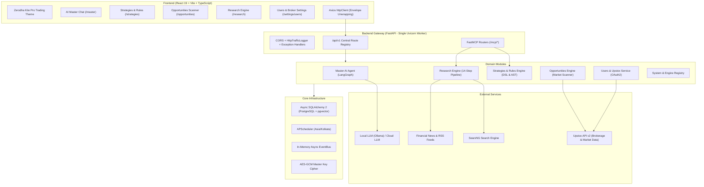

# Auto-Trader Documentation Hub

Welcome to the comprehensive technical documentation for **Auto-Trader**, a high-performance algorithmic trading and quantitative intelligence platform engineered for the Indian equities, futures, and options markets (integrating with the Upstox API v2 ecosystem).

---

## 📚 Documentation Index

The documentation is organized into modular, deep-dive specifications covering system architecture, core infrastructure, individual business modules, frontend architecture, and inter-module execution flows:

| Document | Topic | Description |
|---|---|---|
| [**00. System Architecture**](00-system-architecture.md) | High-Level Architecture | System topology, single Uvicorn worker process model, tech stack matrix, directory layout, strict naming conventions, and repository standards. |
| [**01. Core Infrastructure**](01-core-infrastructure.md) | Shared Core Services | BaseEntity, EntityStatus enum, soft-deletes, universal `ApiResponse` envelope, search & pagination (`BaseFilter`), AES-GCM crypto, APScheduler, and event bus. |
| [**02. Master AI Module**](02-master-ai-module.md) | AI Master Co-Pilot (`master`) | LangGraph 11-step conversational agent, intent routing, gap analysis, back-translation, proposal lifecycle, FastMCP client, tool gateway, and LLM providers. |
| [**03. Strategies & Rules Module**](03-strategies-rules-module.md) | Quantitative DSL & Health (`strategies`) | Rule/Strategy AST definition, evaluation engine, versioning, conflict detection, backtesting indicators, reliability scoring, health quarantine, and FastMCP server. |
| [**04. Research Engine Module**](04-research-engine-module.md) | Autonomous Market Intelligence (`research`) | Multi-source RSS ingestion, polite web crawling, SearxNG search, claim extraction & verification, pgvector 768-dim embeddings, scoring & clearance, and LangGraph pipeline. |
| [**05. Opportunities Module**](05-opportunities-module.md) | Real-Time Trade Scanner (`opportunities`) | Upstox market data provider, instrument catalog, day context & volatility regimes, menu builder, strategy selector, transaction costs, vector trade memory, and card sessions. |
| [**06. Users & Broker Module**](06-users-broker-module.md) | Authentication & Brokerage (`users`) | Multi-user management, Upstox OAuth2 flow, automated token refresh daemon (APScheduler), AES-GCM secret encryption, and live account/margin synchronization. |
| [**07. System & Runtime Module**](07-system-module.md) | System Registry & Diagnostics (`system`) | Centralized execution engine registry, system-wide health checks (PostgreSQL, pgvector, Upstox), background task lifecycle, and runtime state monitoring. |
| [**08. Frontend Architecture**](08-frontend-architecture.md) | React 19 SPA & UI Systems | React 19 + TypeScript, TanStack Query key factories, TanStack Router, TanStack Table manual pagination, Zod form validation, and Zerodha Kite dark trading theme. |
| [**09. Inter-Module Data Flows**](09-inter-module-data-flows.md) | End-to-End Execution Flows | Comprehensive sequence diagrams: Autonomous Market Intelligence, Live Trade Opportunity Generation, Master AI Proposal Lifecycle, Broker Token Renewal, and Health Quarantine. |

---

## 📈 Trading Domain Knowledge Guides

In addition to the technical architecture documentation above, this directory contains foundational trading domain references:

- [**01. Indian Market Basics**](01-indian-market-basics.md): Trading hours (NSE/BSE/MCX), segment codes, settlement cycles, and price bands.
- [**02. Derivatives & Expiry Calendar**](02-derivatives-and-expiry-calendar.md): Weekly and monthly expiry schedules for NIFTY, BANKNIFTY, FINNIFTY, SENSEX, and MCX commodities.
- [**03. Intraday Trading Flow**](03-intraday-trading-flow.md): Market sessions (pre-open, morning momentum, midday consolidation, closing auction).
- [**04. Risk & Profit Management**](04-risk-and-profit-management.md): Position sizing, maximum drawdown rules, reward-to-risk thresholds, and capital allocation.
- [**05. Trading Psychology**](05-trading-psychology.md): Discipline, cognitive biases, avoiding overtrading, and automated guardrails.

---

## 🧭 Architecture Quick Reference

---

## 🛠️ Technology Summary Matrix

| Domain | Technology / Library | Purpose |
|---|---|---|
| **Backend Runtime** | Python 3.12+, FastAPI | Asynchronous REST API, OpenAPI docs, background task runner |
| **Worker Architecture** | Exactly 1 Uvicorn Worker | Thread-safe in-memory state, single scheduler instance, deterministic background execution |
| **Database & ORM** | PostgreSQL 16 + `pgvector`, SQLAlchemy 2 (async), Alembic | Relational data, vector similarity search, schema migrations |
| **AI Orchestration** | LangGraph, LangChain Core, FastMCP | Directed acyclic & cyclic state graphs, structured tool interfaces |
| **Scheduler** | APScheduler (`AsyncIOScheduler`) | Centralized scheduler bound to `Asia/Kolkata` timezone |
| **Cryptography** | `cryptography` (AES-GCM 256-bit) | Vault encryption for Upstox API keys, secrets, and auth tokens |
| **Frontend Framework** | React 19, Vite, TypeScript | Single-page application, strict type safety |
| **State Management** | TanStack Query v5 | Server state caching, optimistic updates, query key factories |
| **Routing** | TanStack Router | Type-safe declarative routing, search params validation |
| **Table & Form Systems** | TanStack Table v8, React Hook Form + Zod | High-performance manual pagination tables, schema-driven validation |
| **Design System** | Eye-Comfort Pro Trading Dark Palette | Custom Zerodha Kite inspired financial terminal UI |

---

## 👥 Audience Guides

- **New Developers**: Start with [00. System Architecture](00-system-architecture.md) and [01. Core Infrastructure](01-core-infrastructure.md) to understand coding conventions, database patterns, and API response wrappers.
- **Quantitative & Strategy Developers**: Read [03. Strategies & Rules Module](03-strategies-rules-module.md) and [05. Opportunities Module](05-opportunities-module.md) to learn how rules are defined, evaluated, and converted into live trade opportunities.
- **AI & Agent Developers**: Read [02. Master AI Module](02-master-ai-module.md) and [04. Research Engine Module](04-research-engine-module.md) to explore LangGraph state machines, MCP server implementations, and vector search pipelines.
- **Frontend Engineers**: Read [08. Frontend Architecture](08-frontend-architecture.md) to understand the component hierarchies, TanStack Query patterns, and Kite dark theme styling.

