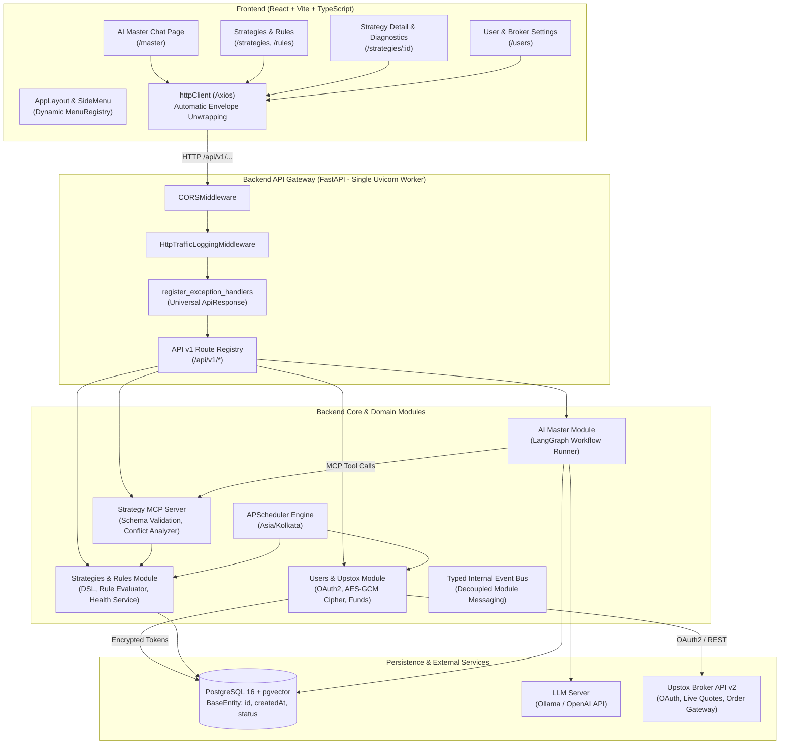
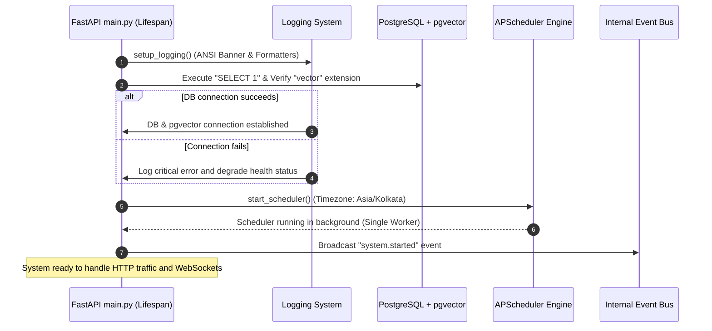
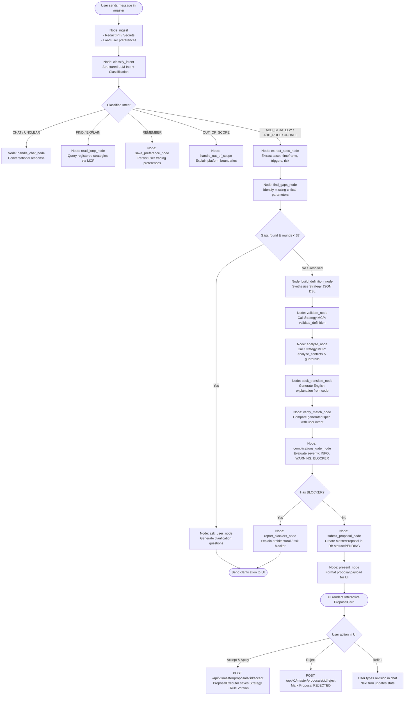
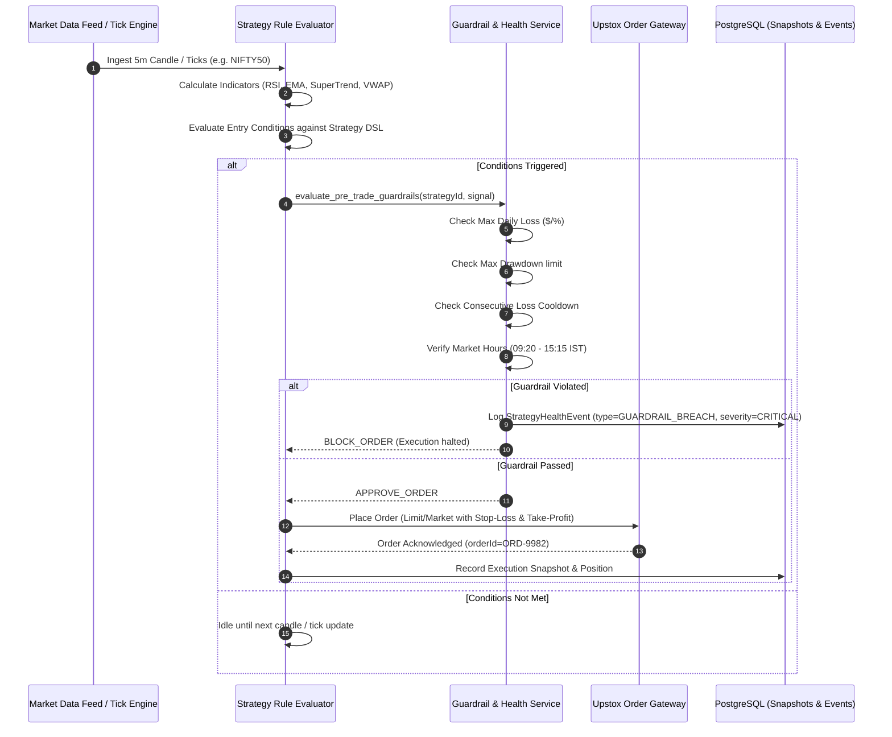
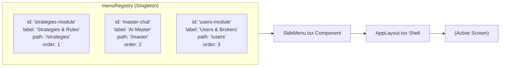

# Auto-Trader System Architecture, Logic & UI Flow Specification

> **Document Type:** Master End-to-End System Specification  
> **Status:** Active & Authoritative  
> **Repository:** `auto-trader`  
> **Companion Documents:** [arch.md](file:///Users/user/Documents/Tests/auto-trader/arch.md), [GEMINI.md](file:///Users/user/Documents/Tests/auto-trader/GEMINI.md), [AGENTS.md](file:///Users/user/Documents/Tests/auto-trader/AGENTS.md)

---

## 1. Executive System Overview

**Auto-Trader** is an algorithmic execution and quantitative strategy platform designed for the Indian equities, futures, and options markets (integrated with the **Upstox API v2** broker ecosystem). The platform combines:
1. **Deterministic Strategy & Rule Evaluation Engine:** Algorithmic definition DSL, real-time indicator calculations, risk guardrails, reliability scoring, and automated health diagnostics.
2. **AI Master Conversational Agent:** An intelligent co-pilot powered by **LangGraph** and local/cloud LLMs (via Ollama or OpenAI-compatible APIs) with Model Context Protocol (MCP) tool servers. The Master translates natural-language trading ideas into rigorously validated strategy code, detects logic conflicts, and presents interactive proposals for user review and one-click deployment.
3. **Multi-User Broker & Credential Management:** Enterprise-grade security with AES-GCM master key encryption for broker secrets, automated OAuth2 token lifecycle management, and live account/funds synchronization.
4. **Reactive Single-Page Application (SPA):** Built with React 19, TypeScript, TanStack Query, TanStack Router, TanStack Table, and Tailwind/Vanilla CSS, enforcing zero-casing-conversion (camelCase throughout).

---

## 2. Global Architecture & Stack Blueprint

### 2.1 Technology Stack Matrix

| Layer | Technology | Key Configuration / Purpose |
|---|---|---|
| **Backend Framework** | Python 3.12+, FastAPI | Single Uvicorn Worker (PID bound) to preserve in-memory state and schedulers |
| **Database & ORM** | PostgreSQL 16 + `pgvector`, SQLAlchemy 2 (async), Alembic | Soft-deletes (`status = 1/0`), partial unique indexes, vector similarity |
| **Scheduler** | APScheduler (AsyncIOScheduler) | Centralized scheduler bound to `Asia/Kolkata` timezone |
| **AI Orchestration** | LangGraph, LangChain Core | Cyclic directed graphs for intent classification, spec extraction, back-translation |
| **LLM & Tooling** | Ollama / Cloud LLM + FastMCP | Structured JSON output, Strategy MCP Tools (`strategy_mcp_server`) |
| **Cryptography** | `cryptography` (AES-GCM 256-bit) | Master key from environment (`APP_MASTER_ENCRYPTION_KEY`) for broker secrets |
| **Frontend Core** | React 19, Vite, TypeScript | Modern component architecture, dark/light theme, rich dashboard visualizers |
| **Frontend Routing** | TanStack Router | Type-safe URL routes, nested layouts, programmatic redirects |
| **Data Fetching** | TanStack Query v5 | Key factories, `keepPreviousData`, query cache, mutation invalidations |
| **Tables & Forms** | TanStack Table v8, React Hook Form + Zod | Manual server-side pagination, strict client-side validation |
| **HTTP Clients** | `httpx` (Backend), `Axios` (Frontend) | Envelope unwrapping (`httpClient.ts`) with custom `ApiError` hierarchy |

---

### 2.2 System Topology Diagram



---

## 3. Core Architectural Contracts & Invariants

### 3.1 Base Entity & Soft Delete Standard
Every database entity in the system inherits from `BaseEntity` ([base_entity.py](file:///Users/user/Documents/Tests/auto-trader/backend-service/app/core/db/base_entity.py)):

```text
Database Column (snake_case)       Python Entity (camelCase)         JSON / API Schema (camelCase)
--------------------------------------------------------------------------------------------------
id (BigInteger, PK)           --> id: Mapped[int]               --> id: int
created_at (TIMESTAMPTZ)      --> createdAt: Mapped[datetime]   --> createdAt: str (ISO 8601)
status (SmallInteger 1 or 0)  --> status: Mapped[EntityStatus]  --> status: "ACTIVE" | "DELETED"
```

- **Type Decorator:** `StatusType` ([status_type.py](file:///Users/user/Documents/Tests/auto-trader/backend-service/app/core/db/status_type.py)) marshals between PostgreSQL integer (`1` = Active, `0` = Deleted) and `EntityStatus` enum.
- **Soft Delete Only:** Rows are never removed with `DELETE SQL`. Deleting transitions `status` to `DELETED`.
- **Query Filter:** Repositories filter `status == EntityStatus.ACTIVE` by default.
- **Partial Unique Indexes:** All unique constraints use partial indexes (e.g. `CREATE UNIQUE INDEX uq_strategy_code ON strategies (code) WHERE status = 1;`), allowing reuse of codes/names after deletion.

### 3.2 Universal API Response Envelope
Every endpoint across the platform strictly returns the `ApiResponse[T]` envelope:

```json
{
  "statusCode": 200,
  "data": { ... },
  "message": "Operation completed successfully",
  "error": null
}
```

- **On Validation Error (400):** `error` is an array: `[{ "field": "code", "message": "Code is required" }]`.
- **On Business Conflict (409):** `error` is a structured error object: `{ "code": "RESOURCE_CONFLICT", "details": "..." }`.
- **On Internal Error (500):** `data` is `null`, `message` is generic ("Internal server error"), and `error` is `null` (zero internal leaking).

### 3.3 Search & Pagination Standard
All list screens consume a standardized `POST /api/v1/<resource>/search` endpoint:
- **Request Body:** Extends `BaseFilter` (`page` [0-indexed], `limit` [1-100], `sortBy`, `sortDir`, `status`, `query`, `dateFilter: { from, to }`).
- **Response Data:** `PageResult[T]` containing `list: T[]`, `page: int`, `limit: int`, `totalPages: int`, `totalItems: int`.
- **Central Filter Application:** Executed uniformly via `core/filter/filter_builder.py`.

---

## 4. End-to-End System Logic Flows

### 4.1 System Boot & Lifecycle Initialization Flow



---

### 4.2 Multi-User & Upstox Broker OAuth2 Flow

```mermaid
sequenceDiagram
    autonumber
    actor Trader as User / Trader
    participant UI as Frontend UsersPage
    participant API as User & OAuth Controller
    participant Service as UserService & SecretCipher
    participant DB as PostgreSQL
    participant Upstox as Upstox Broker OAuth Server

    Trader->>UI: Click "Add User" & Enter Name, Email, Role
    Trader->>UI: Enter Upstox apiKey & apiSecret
    UI->>API: POST /api/v1/users (payload with secrets)
    API->>Service: create_user(dto)
    Service->>Service: SecretCipher.encrypt(apiKey), encrypt(apiSecret)
    Service->>DB: INSERT INTO users & upstox_configs (encrypted)
    DB-->>Service: User created (id=101)
    Service-->>API-->>UI: 201 Created (ApiResponse with user details, secrets omitted)

    Trader->>UI: Click "Authorize with Upstox"
    UI->>API: GET /api/v1/oauth/upstox/authorize?userId=101
    API-->>UI: Return Upstox Auth URL with redirectUri & state
    UI->>Upstox: Redirect user to Upstox Login / 2FA Portal
    Trader->>Upstox: Enters Upstox PIN & OTP
    Upstox->>API: Redirects to /api/v1/oauth/upstox/callback?code=AUTH_CODE&state=101
    API->>Service: exchange_code_for_token(userId=101, code)
    Service->>Upstox: POST https://api.upstox.com/v2/login/authorization/token
    Upstox-->>Service: Access Token, Expiry & User Profile
    Service->>Service: SecretCipher.encrypt(accessToken)
    Service->>DB: UPDATE upstox_configs (token, expiresAt, status=ACTIVE)
    Service->>Upstox: GET /v2/user/profile & GET /v2/user/get-funds-and-margin
    Upstox-->>Service: Profile & Margins
    Service->>DB: Cache User Profile & Available Margin
    API-->>UI: Redirect back to /users?status=success
    UI->>UI: Invalidate ['users'] query cache & display "Connected" badge
```

---

### 4.3 AI Master Strategy Creation Flow (LangGraph Pipeline)

The AI Master agent workflow coordinates state across 18 graph nodes, ensuring that no strategy or risk rule is deployed without multi-stage validation, gap-filling, conflict analysis, and explicit human authorization.



---

### 4.4 Strategy Definition & Risk Rule Evaluation Flow



---

## 5. UI Architecture & Screen Navigation Flows

### 5.1 Route Tree & Page Hierarchy

The frontend uses **TanStack Router** configured in [router.tsx](file:///Users/user/Documents/Tests/auto-trader/frontend/src/app/router/router.tsx), structured around the unified `AppLayout` shell:

```text
/ (Index) ─────────────────────────► Redirects to /strategies
│
├── /master ───────────────────────► MasterPage (AI Co-pilot Chat, Proposals, Tool Registry)
│
├── /strategies ───────────────────► StrategiesPage (List / Grid, FilterBar, Health Badges)
│   ├── /create ───────────────────► StrategyEditorPage (Visual Strategy Creator)
│   ├── /$id ──────────────────────► StrategyDetailPage (Performance, Visual DSL, Health, Versions)
│   └── /$id/edit ─────────────────► StrategyEditorPage (Edit existing strategy draft)
│
├── /rules ────────────────────────► RulesPage (Standalone Risk Guardrails & Circuit Breakers)
│
└── /users ────────────────────────► UsersPage (Multi-user directory, Upstox OAuth2 & Credentials)
    └── (Alias: /settings/users)
```

---

### 5.2 Application Shell & Dynamic Menu Registry

The navigation sidebar (`SideMenu.tsx`) does not hardcode route links. Instead, each feature module registers its menu definition dynamically into the singleton `menuRegistry` ([menuRegistry.ts](file:///Users/user/Documents/Tests/auto-trader/frontend/src/core/navigation/menuRegistry.ts)):



---

### 5.3 Detailed Screen Specifications

#### 1. AI Master Co-Pilot (`/master`)
- **Primary Purpose:** Conversational trading assistant that reads strategies from the database, invents new quantitative strategies, modifies existing rules, and validates against risk constraints.
- **Key Visual Elements:**
  - **Sidebar:** Recent conversations list, "New Conversation" button, conversation deletion.
  - **Header:** Connection status to LLM (Ollama/Cloud), Master Health Badge (`HEALTHY`, `DEGRADED`), Active Tool Servers count.
  - **Message Stream:**
    - User message bubbles (timestamped, styled).
    - Assistant message bubbles with syntax-highlighted code and markdown.
    - **Thinking Indicator:** Animated real-time pulse showing the current LangGraph step (`"Classifying intent..."`, `"Extracting spec..."`, `"Validating via MCP..."`, `"Analyzing risk complications..."`).
  - **Interactive Proposal Card (`ProposalCard.tsx`):**
    - Rendered when the Master generates a strategy/rule proposal.
    - **Tabs:**
      - *Overview:* Type (`STRATEGY_ADD`, `RULE_ADD`, `STRATEGY_MODIFY`), Code, Name, Timeframe, Summary.
      - *Definition:* Formatted JSON DSL with syntax highlighting and copy button.
      - *Diff:* Visual side-by-side diff showing exact changes against previous version.
      - *Parity & Complications:* Match rate between user prompt and generated spec; warning badges for edge cases or high slippage.
    - **Actions:**
      - `[Accept & Apply]` $\rightarrow$ Calls `POST /api/v1/master/proposals/{id}/accept`, writes directly to DB, shows toast, switches badge to `ACCEPTED`.
      - `[Reject]` $\rightarrow$ Prompts for rejection reason, updates status to `REJECTED`.
      - `[Refine]` $\rightarrow$ Prefills chat input to request modifications.
  - **Chat Input (`ChatInput.tsx`):** Auto-resizing text area, quick prompt suggestion chips (*"Show active strategies"*, *"Add 2% max daily loss guardrail"*, *"Build 15m RSI breakout"*), submit button.

---

#### 2. Strategies Hub (`/strategies`)
- **Primary Purpose:** Central mission-control for browsing, filtering, pausing, and launching trading strategies.
- **Key Visual Elements:**
  - **Header KPI Bar:** Total Active Strategies, Portfolio Win Rate, Daily Realized PnL, System Health State.
  - **Unified `FilterBar.tsx`:**
    - Free-text debounced search (`query`).
    - Status dropdown: `ACTIVE`, `DELETED`, `DRAFT`, `PAUSED`, `ARCHIVED`.
    - Date range picker (`from` $\rightarrow$ `to` filtering on `createdAt`).
    - Reset Filters button.
  - **View Toggles:** Grid view (interactive cards) and Table view (TanStack Table with manual pagination).
  - **Strategy Card (`StrategyCard.tsx`):**
    - Header: Strategy Name, Unique Code, Asset Tag (`EQUITY`, `FUTURES`, `OPTIONS`).
    - Badges: Lifecycle badge (`ACTIVE`, `PAUSED`, `DRAFT`), Health indicator badge (`HEALTHY`, `WARNING`, `CRITICAL`).
    - Key Metrics: Win Rate %, Profit Factor, Max Drawdown %, Reliability Score (0–100 gauge).
    - Linked Guardrails count (e.g. *"3 Risk Rules Attached"*).
    - **Actions:** Quick Toggle (Play/Pause), Edit, Duplicate, Run Backtest/Simulation, Archive.
  - **Top Actions:** `[Create Strategy]` button (routes to `/strategies/create`), `[Import / Export]` batch modal.

---

#### 3. Strategy Detail & Diagnostics (`/strategies/:id`)
- **Primary Purpose:** Deep-dive analysis into an individual strategy's logic, health events, execution logs, and version lineage.
- **Key Visual Elements:**
  - **Breadcrumbs:** `Strategies > [Strategy Code]`.
  - **Summary Banner:** Live status, asset class, timeframe, capital allocation, linked user.
  - **Sub-View Sections:**
    1. **Overview & Performance (`PerformanceSection.tsx`):** Equity curve chart, Monthly PnL heatmap, Average Trade Duration, Win/Loss Ratio.
    2. **Definition Viewer (`DefinitionViewer.tsx`):** Interactive visualization of the Strategy DSL:
       - Entry Blocks (Indicators, Comparative operators, Candle offsets).
       - Exit Blocks (Target, Stop-loss, Trailing SL, Time-based exit).
       - JSON DSL raw code view with syntax coloring.
    3. **Guardrails & Risk Rules (`RequirementsSection.tsx`):** List of attached rules (e.g., Portfolio Loss Cap, Max Positions). Ability to link/unlink rules directly.
    4. **Health & Diagnostics (`HealthSection.tsx`):** Recent system anomalies, execution slip alerts, latency warnings, and automatic degradation history.
    5. **Version History (`VersionsSection.tsx`):** Chronological log of versions (`v1.0`, `v1.1`, `v2.0`), author, changelog comments, and one-click **Rollback** button.
    6. **Test & Simulation Sandbox (`StrategyTestPanel.tsx`):** In-browser dry-run against historical or synthetic candles with detailed execution logs.

---

#### 4. Strategy Visual Editor (`/strategies/create` & `/strategies/:id/edit`)
- **Primary Purpose:** Structured form + JSON editor for authoring and fine-tuning trading strategies.
- **Key Visual Elements:**
  - **Step 1: General Info:** Strategy Name, Identifier Code, Description, Asset Type, Base Timeframe.
  - **Step 2: Capital & Sizing:** Fixed Quantity / Risk-based sizing % of available capital, Leverage limit.
  - **Step 3: Signal Triggers (Visual Builder):** Add condition rows (e.g. `RSI(14, CLOSE) CROSSES_ABOVE 30` AND `CLOSE > EMA(200)`).
  - **Step 4: Exit & Protection:** Profit Target (Ticks / % / Risk-to-Reward ratio), Stop Loss, Trailing Stop trigger and step.
  - **Step 5: Code / JSON Preview & Validation:** Live validation against `DefinitionValidator` with instant inline syntax error markers.
  - **Step 6: Attached Guardrails:** Checkboxes for system-wide and account-level risk rules.
  - **Footer:** `[Save as Draft]`, `[Publish & Activate]`, `[Cancel]`.

---

#### 5. Rules & Risk Guardrails Hub (`/rules`)
- **Primary Purpose:** Definition and global management of safety guardrails, account protection rules, and emergency kill-switches.
- **Key Visual Elements:**
  - **Header:** Active Kill-Switch status (*"Platform Circuit Breakers: ENGAGED"*).
  - **Rule List Table:** Rule Code, Rule Type (`MAX_DAILY_LOSS`, `MAX_DRAWDOWN`, `CONSECUTIVE_LOSS_LIMIT`, `MAX_OPEN_POSITIONS`, `TIME_WINDOW`), Scope (`GLOBAL`, `STRATEGY`, `ACCOUNT`), Severity (`INFO`, `WARNING`, `BLOCK_ORDER`, `EMERGENCY_SQUARE_OFF`).
  - **Rule Creation / Edit Modal:**
    - Rule Name & Code.
    - Parameter inputs (e.g. Threshold value, percentage, time window in HH:MM).
    - Action when triggered (Reject new orders, Pause offending strategy, Liquidate all open positions, Alert user).
  - **Associated Strategies Counter:** Quick drill-down to see which strategies currently obey this rule.

---

#### 6. Users & Broker Management (`/users`)
- **Primary Purpose:** Multi-tenant user directory, credential vaults, and Upstox OAuth2 connection lifecycle.
- **Key Visual Elements:**
  - **User Directory Table (`UserTable.tsx`):** Name, Email, Role (`ADMIN`, `TRADER`, `VIEWER`), Created Date, Broker Status (`CONNECTED`, `EXPIRED`, `DISCONNECTED`, `NOT_CONFIGURED`).
  - **Broker Status Pill:** Color-coded (Green = Token Active, Orange = Expires within 2 hours, Red = Disconnected).
  - **Action Buttons:**
    - `[Connect / Reauthorize Upstox]`: Triggers the OAuth2 redirect flow.
    - `[View Account Margins]`: Opens a modal displaying live Upstox funds (Available Margin, Used Margin, Realized MTM).
    - `[Edit User]`: Opens `UserDialog.tsx` to modify name, email, role, or update API credentials.
    - `[Soft Delete]`: Disables user and revokes broker sessions.
  - **User Dialog Modal (`UserDialog.tsx`):**
    - User Profile fields (Name, Email, Mobile).
    - Upstox API Credentials fields (`apiKey`, `apiSecret`, `redirectUri`).
    - *Security guarantee:* Secrets are masked on edit; backend uses AES-GCM cipher and never transmits raw secrets back over the wire.

---

## 6. Data Schemas & API Contracts

### 6.1 Universal Envelope Types (`core/types/apiResponse.types.ts`)

```typescript
export interface ApiResponse<T> {
  statusCode: number;
  data: T | null;
  message: string;
  error: unknown | null;
}

export interface ApiValidationError {
  field: string;
  message: string;
}
```

### 6.2 Filter & Pagination Types (`core/types/filter.types.ts`)

```typescript
export interface DateFilter {
  from: string | null; // ISO 8601 string
  to: string | null;   // ISO 8601 string
}

export interface BaseFilter {
  page: number;        // Zero-based index (0, 1, 2...)
  limit: number;       // Range: 1 to 100 (default: 10)
  sortBy?: string;     // Default: "createdAt"
  sortDir?: "asc" | "desc"; // Default: "desc"
  status?: "ACTIVE" | "DELETED"; // Default: "ACTIVE"
  query?: string;      // Case-insensitive text search
  dateFilter?: DateFilter | null;
}

export interface PageResult<T> {
  list: T[];
  page: number;
  limit: number;
  totalPages: number;
  totalItems: number;
}
```

### 6.3 Strategy JSON DSL Schema

```json
{
  "$schema": "http://json-schema.org/draft-07/schema#",
  "title": "StrategyDefinition",
  "type": "object",
  "required": ["code", "name", "assetClass", "timeframe", "entry", "exit"],
  "properties": {
    "code": { "type": "string", "pattern": "^[A-Z0-9_]{3,30}$" },
    "name": { "type": "string", "minLength": 3, "maxLength": 100 },
    "assetClass": { "type": "string", "enum": ["EQUITY", "FUTURES", "OPTIONS"] },
    "timeframe": { "type": "string", "enum": ["1m", "3m", "5m", "15m", "30m", "1h", "1d"] },
    "entry": {
      "type": "object",
      "required": ["type", "conditions"],
      "properties": {
        "type": { "type": "string", "enum": ["LONG", "SHORT"] },
        "conditions": {
          "type": "array",
          "items": {
            "type": "object",
            "required": ["left", "operator", "right"],
            "properties": {
              "left": { "type": "string", "description": "e.g. RSI(14) or CLOSE" },
              "operator": { "type": "string", "enum": [">", "<", ">=", "<=", "==", "CROSSES_ABOVE", "CROSSES_BELOW"] },
              "right": { "type": "string", "description": "e.g. 30 or EMA(200)" }
            }
          }
        }
      }
    },
    "exit": {
      "type": "object",
      "required": ["targetPercent", "stopLossPercent"],
      "properties": {
        "targetPercent": { "type": "number", "minimum": 0.1 },
        "stopLossPercent": { "type": "number", "minimum": 0.1 },
        "trailingStop": {
          "type": "object",
          "properties": {
            "activationPercent": { "type": "number" },
            "trailPercent": { "type": "number" }
          }
        },
        "timeExit": { "type": "string", "pattern": "^[0-2][0-9]:[0-5][0-9]$" }
      }
    },
    "positionSizing": {
      "type": "object",
      "required": ["type", "value"],
      "properties": {
        "type": { "type": "string", "enum": ["FIXED_QTY", "PERCENT_CAPITAL", "RISK_PER_TRADE"] },
        "value": { "type": "number", "minimum": 1 }
      }
    }
  }
}
```

---

## 7. Security, Cryptography & Operational Policies

### 7.1 Broker Secret Encryption (AES-GCM)
- Master encryption key is supplied strictly via the environment variable `APP_MASTER_ENCRYPTION_KEY` (32 bytes / 256 bits).
- All sensitive credentials (`apiKey`, `apiSecret`, `accessToken`, `refreshToken`) stored in the `upstox_configs` table are encrypted before persistence using `core/crypto/secret_cipher.py`.
- Nonce/IV is dynamically generated per encryption operation and prefixed to the ciphertext payload.
- API endpoints **never** serialize or return raw credentials. In the frontend, credentials display as `••••••••` placeholders.

### 7.2 Process Concurrency & Scheduler Guarantees
- Auto-Trader enforces **strictly one Uvicorn worker process** (`workers = 1`).
- This design guarantees that:
  - In-memory WebSocket connections to Upstox market feeds have a single authoritative coordinator.
  - APScheduler jobs (candle generation, health checks, token refreshes) execute with zero duplicate race conditions or distributed locking overhead.
  - LangGraph conversational states and active execution graph checkpoints remain localized and low-latency.

### 7.3 Circuit Breakers & Risk Kill-Switches
- If account drawdown exceeds the configured `MAX_PORTFOLIO_DRAWDOWN_PERCENT` (default: 5.0%), the `GuardrailService`:
  1. Sets an in-memory lock rejecting all subsequent entry signals.
  2. Issues emergency market cancel requests for all pending limit orders.
  3. Sends market-exit liquidation orders for all active positions across strategies.
  4. Dispatches a high-priority notification via the internal event bus.

---

## 8. Summary & Reference Matrix

| Feature Domain | Primary Backend Files | Primary Frontend Files | Endpoints |
|---|---|---|---|
| **Users & Broker** | [user_service.py](file:///Users/user/Documents/Tests/auto-trader/backend-service/app/modules/users/service/user_service.py)<br/>[oauth_service.py](file:///Users/user/Documents/Tests/auto-trader/backend-service/app/modules/users/service/oauth_service.py)<br/>[secret_cipher.py](file:///Users/user/Documents/Tests/auto-trader/backend-service/app/core/crypto/secret_cipher.py) | [UsersPage.tsx](file:///Users/user/Documents/Tests/auto-trader/frontend/src/modules/users/pages/UsersPage.tsx)<br/>[UserDialog.tsx](file:///Users/user/Documents/Tests/auto-trader/frontend/src/modules/users/components/UserDialog.tsx) | `POST /api/v1/users/search`<br/>`POST /api/v1/users`<br/>`GET /api/v1/oauth/upstox/authorize`<br/>`GET /api/v1/oauth/upstox/callback` |
| **AI Master Co-Pilot** | [builder.py](file:///Users/user/Documents/Tests/auto-trader/backend-service/app/modules/master/graph/builder.py)<br/>[master_nodes.py](file:///Users/user/Documents/Tests/auto-trader/backend-service/app/modules/master/graph/nodes/master_nodes.py)<br/>[proposal_service.py](file:///Users/user/Documents/Tests/auto-trader/backend-service/app/modules/master/service/proposal_service.py) | [MasterPage.tsx](file:///Users/user/Documents/Tests/auto-trader/frontend/src/modules/master/pages/MasterPage.tsx)<br/>[ProposalCard.tsx](file:///Users/user/Documents/Tests/auto-trader/frontend/src/modules/master/components/ProposalCard.tsx) | `POST /api/v1/master/chat`<br/>`POST /api/v1/master/proposals/search`<br/>`POST /api/v1/master/proposals/:id/accept`<br/>`POST /api/v1/master/proposals/:id/reject` |
| **Strategies & DSL** | [strategy_service.py](file:///Users/user/Documents/Tests/auto-trader/backend-service/app/modules/strategies/service/strategy_service.py)<br/>[definition_validator.py](file:///Users/user/Documents/Tests/auto-trader/backend-service/app/modules/strategies/service/definition_validator.py)<br/>[health_service.py](file:///Users/user/Documents/Tests/auto-trader/backend-service/app/modules/strategies/service/health_service.py) | [StrategiesPage.tsx](file:///Users/user/Documents/Tests/auto-trader/frontend/src/modules/strategies/pages/StrategiesPage.tsx)<br/>[StrategyDetailPage.tsx](file:///Users/user/Documents/Tests/auto-trader/frontend/src/modules/strategies/pages/StrategyDetailPage.tsx)<br/>[StrategyEditorPage.tsx](file:///Users/user/Documents/Tests/auto-trader/frontend/src/modules/strategies/pages/StrategyEditorPage.tsx) | `POST /api/v1/strategies/search`<br/>`GET /api/v1/strategies/:id`<br/>`POST /api/v1/strategies`<br/>`PUT /api/v1/strategies/:id`<br/>`POST /api/v1/strategies/:id/pause` |
| **Rules & Guardrails** | [rule_service.py](file:///Users/user/Documents/Tests/auto-trader/backend-service/app/modules/strategies/service/rule_service.py)<br/>[rule_evaluator.py](file:///Users/user/Documents/Tests/auto-trader/backend-service/app/modules/strategies/service/rule_evaluator.py)<br/>[guardrail_service.py](file:///Users/user/Documents/Tests/auto-trader/backend-service/app/modules/strategies/service/guardrail_service.py) | [RulesPage.tsx](file:///Users/user/Documents/Tests/auto-trader/frontend/src/modules/strategies/pages/RulesPage.tsx) | `POST /api/v1/rules/search`<br/>`POST /api/v1/rules`<br/>`PUT /api/v1/rules/:id`<br/>`POST /api/v1/strategies/:id/rules/:ruleId` |
